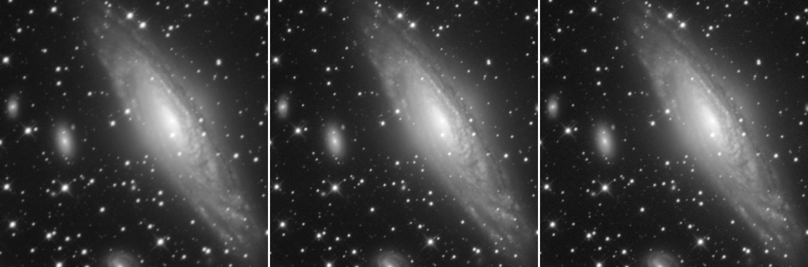
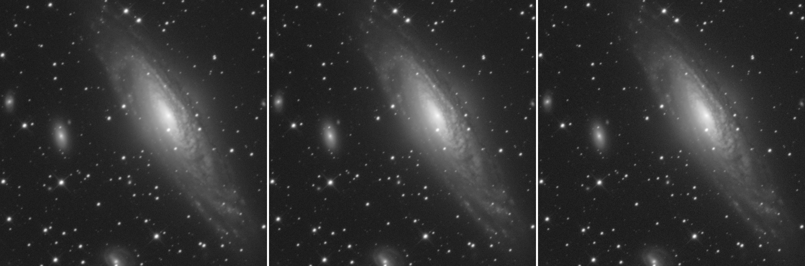
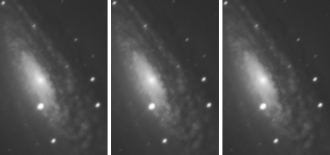
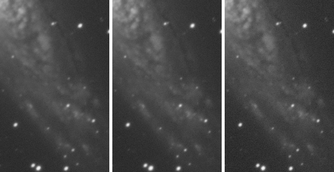
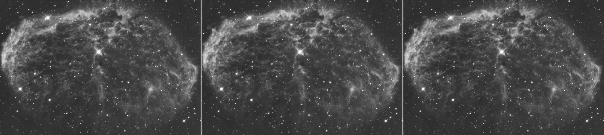
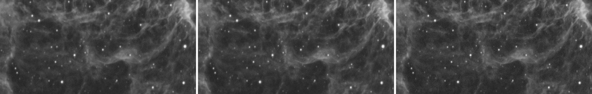
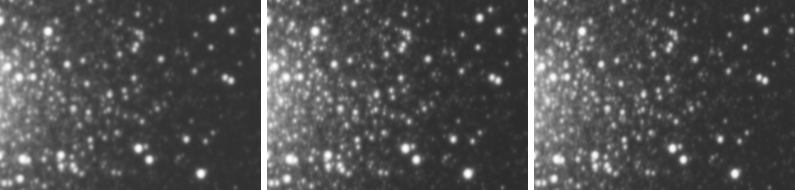
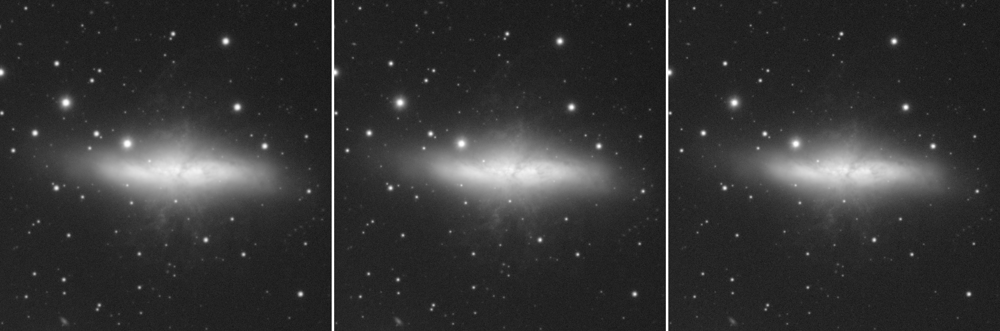

# 分区权重叠加法的原理与实现

**Partition-Weighted Stacking (PWS): Principle, Implementation and Multi-Target Validation**

作者：**D.Cikey**　·　版本 v3.5　·　2026-10-14

**转载与使用**　本文以 **CC BY 4.0** 发布（<https://creativecommons.org/licenses/by/4.0/deed.zh>），配套软件实现以 **MIT** 许可证发布。欢迎转载、翻译、改编、二次开发乃至商用，**无需另行申请、无需付费**；只请保留作者署名 **D.Cikey**，注明方法出自「**分区权重叠加法（Partition-Weighted Stacking，PWS）**」，并附上原文链接。

**致谢写法**　下面这句可以直接复制到你的文章、项目 README 或视频简介里：

> 本文/本项目的方法基于 **D.Cikey** 提出的**分区权重叠加法（Partition-Weighted Stacking，PWS）**，原文见 <https://github.com/DDCikey/Partition-Weighted-Stacking/tree/main/docs>；PDF 版可在微信公众号「小丁的星空」下载。

---

## 摘要

深空天体摄影的图像质量取决于能否把多张质量参差的单帧合理融合。经典加权平均叠加为每一帧分配一个权重（帧与帧之间可以不同），但整幅画面共用这同一组权重、它不随画面位置变化，因此无法表达“同一张单帧在星点与细节区域已经无法使用、在大面积朦胧背景上仍能贡献信噪比”这一事实；而质量筛选（直接删除差帧）则完全浪费了被删帧的曝光时间。本文提出**分区权重叠加法**（Partition-Weighted Stacking，PWS）：先对画面逐像素判定“此处是细节型还是朦胧型”，得到一个取值于 $`[0,1]`$ 的连续分区场 $`R`$；再按下式融合三类权重

$$
W_{i,r} = C_i^{\,A\,R_r}\cdot S_i^{\,B\,(1-R_r)},
$$

其中 $`C_i`$ 为第 $`i`$ 帧的清晰度权重、$`S_i`$ 为其信噪比权重（二者均为帧级标量），$`R_r`$ 为像素 $`r`$ 处的分区权重。$`R=1`$ 处权重只由清晰度决定，$`R=0`$ 处只由信噪比决定，中间连续过渡。**分区场 $`R`$ 的空间与数值尺度**均由图像自身统计量定标（星点 FWHM、天空噪声、实测点扩散函数尺度），不依赖目标的绝对亮度、曝光、增益与滤镜；$`B=2`$ 由“逆方差加权是方差最优解”直接给出、无需标定，故方法参数中仅 $`A`$ 需经验标定。需说明的是，星点测量与包络构造所用的窗尺寸按绝对像素给定、不随 $`\sigma_{\mathrm{psf}}`$ 缩放；当采样率与本文数据集相差较大时，需要重设的是星点拟合窗、包络窗与参数 $`A`$——重设对象与欠采样界线在 3.4.2、7.4 节说明。

本文的核心主张是：**权重的空间分配本身，是深空叠加中一个在作者所知范围内尚未被开发的自由度。** 既有做法的帧权重或在整幅画面内不随位置变化（经典加权平均：帧与帧之间可以不同，但画面内共用同一组值），或源于仪器与几何因素（巡天 coadd 的深度不均、Drizzle 的重采样面积），或源于对焦与大气瞬变（多焦点融合、幸运成像）；另一条取向相反的路线是先把各帧 PSF 同质化再组合（最优线性组合），它以牺牲锐帧高频为代价换取输出核的空间一致，本文则在保留各帧 PSF 的前提下把取舍下放到逐像素（第 2.5 节）。分区叠加把这一自由度显式参数化为单一的 $`[0,1]`$ 场 $`R`$，从而能在同一幅成品里让结构区吃清晰度、背景区吃信噪比；它在朦胧区退化为逆方差加权（在该区噪声独立且各帧对同一真值无偏的前提下保留最优信噪比），在细节区以幂次权重逼近最锐帧（因而不受子集平均的拖累）。这一“两头兼得”是本文全部定量结果的共同来源。

我们在八个差异很大的数据集上做了整幅画面验证：星系 NGC 7331（L/R/G/B 四通道）与 M81、发射星云 NGC 6888 与 NGC 6992（Hα 窄带）、球状星团 M15，帧数 32～166、单帧曝光 120～900 s 混曝，全部共用同一组参数（$`A=20`$、$`B=2`$）。成品星点 FWHM 相对单帧中位改善 8.3%～43.0%，改善幅度与该数据集的帧间清晰度离散度同步：$`C_i`$ 跨 2.81 倍的 NGC 6888 改善 43.0%，帧间离散度很小的 M15（$`C_i`$ 上端 1.22）只改善 8.3%——清晰度加权能兑现的正是数据里真实存在的质量差异。分区场仅覆盖画面 0.11%～0.22% 的像素（$`R>0.5`$ 处），其余主体区域严格退化为逆方差加权；整幅画面消融中天空背景噪声相对“无分区基线”仅上升 1.2%（NGC 7331 L）与 1.2%（NGC 6888 H）。

进一步，我们把本文方法与传统全帧叠加、以及“按单帧 FWHM 取最锐前 50% 帧再叠加”（挑帧叠加）在同一批单帧上做了逐像素对照：八个数据集各出三幅几何对齐的成品，共 24 幅。结果一致且分层：**相对传统叠加，分区叠加在每一个测量的目标上星点核都更细**（高斯拟合 FWHM 改善 2.5%～11.9%，逐星配对 88%～99% 的星更细），**延展结构的边缘过渡宽度在七个可比数据集上全部更锐**（低 1.6%～8.8%，六个显著），相对噪声在全部八个通道上更低（低 2.5%～15.7%），且在全部八个通道上优于挑帧叠加（低 15.2%～38.0%）。相对挑帧叠加，星点核的胜负随目标而变：NGC 6888 上分区叠加更细（0.03 px）、NGC 7331 L 打平（0.006 px），M15 上挑帧更细（0.20 px）——胜负由挑帧子集内部的剩余清晰度极差决定（表 8）；延展结构细节上同样无一致方向（三个数据集分区显著更锐、一个挑帧更锐、三个打平，表 7）。但挑帧为此付出的代价是整幅画面的相对噪声全面偏高——这是它舍弃一半曝光、换取星点核锐度所付的代价。衡量能量集中的度量（半光半径）在全部八个数据集上以挑帧叠加为最优（半光半径小 1.8%～6.5%）；而在星点外围（$`r\in[9,12]`$ px 环带）的能量占比上，分区与传统叠加相当、总体高于挑帧——星点核与星点外围这两类度量给出不同方向，只看其中一个都会得出片面的印象，必须一起读（6.3 节）。细节度量本身另经外部已知真值验证：对同一集成成品施加力度 1.0 与 1.5 两档卷积，测得的过渡宽度排序与卷积力度完全一致且全部显著（6.3 节）。就总体取舍而言，分区叠加以远低于挑帧叠加的噪声代价取得与挑帧相当或更好的星点核；它与传统叠加相比的噪声优势，来自朦胧区逐像素的逆方差加权——逆方差加权把帧间噪声极差（1.89×～5.41×）完整转化为权重差异。

本文进一步分析了分区加权特有的**星周亮度平台（目视表现为“亮—暗—亮”伪影环）**这一伪影。我们给出其解析成因：输出亮度剖面是两种有效点扩散函数（锐帧加权与全帧平均）随半径变化混合的结果，混合比的径向导数 $`R'(r)`$ 与两者之差 $`\Delta\mathrm{PSF}(r)`$ 相乘产生一个额外项

$$
-\frac{dR}{dr}\Big[\mathrm{PSF}_{\mathrm{mean}}(r)-\mathrm{PSF}_{\mathrm{sharp}}(r)\Big],
$$

在星翼处 $`dR/dr<0`$ 而 $`\mathrm{PSF}_{\mathrm{mean}}>\mathrm{PSF}_{\mathrm{sharp}}`$，该额外项为正，抵消了自然衰减，于是剖面“变平”。我们进而导出两个高斯型点扩散函数的**交越半径**（两种有效 PSF 相等处的半径，即星点剖面由“锐帧主导”转为“平均帧主导”的分界半径）仅弱依赖于帧质量离散度：$`r_c/\sigma_{\mathrm{psf}} = 2\sqrt{\ln\rho/(\rho^2-1)}`$（$`\rho=\sigma_{\mathrm{mean}}/\sigma_{\mathrm{sharp}}`$，本文数据集 $`\rho\in[1.20,1.91]`$ 对应 $`r_c/\sigma_{\mathrm{psf}}\in[0.99,1.29]`$）。据此得到设计准则：**分区过渡必须在约 $`2\sigma_{\mathrm{psf}}`$ 内完成**，且其位置必须由 $`\sigma_{\mathrm{psf}}`$ 定义而非由绝对对比度阈值定义——后者会随星点亮度漂移，这正是“换目标就必须重新调参”的根源。据此设计的**亮度归一包络**映射在双目标上同时满足“无平台、无噪声台阶、保留锐化”三条约束，而基于对比度阈值的三种映射均在至少一个目标上失败。

**关键词**：分区权重叠加（PWS）；图像叠加；加权平均；天文图像处理；深空摄影；点扩散函数；逆方差加权

---

## 1 引言

### 1.1 深空叠加的基本流程与问题

深空天体（星系、星云、星团）极为暗弱，单次曝光难以获得足够信噪比，通行做法是对同一视场重复拍摄多张单帧再叠加为一张成品。叠加的收益有二：随机噪声按 $`\sqrt N`$ 摊薄；帧间随机性（大气抖动、跟踪残差）被部分平均掉。

但单帧质量往往不稳定。阵风、视宁度波动、赤道仪跟踪偏差、温度引起的离焦、对焦漂移，都会使某些单帧整体或局部变糊。经典流程为：

1. 对单帧做预处理（校准、对齐、归一化）；
2. 计算一个**全局**质量权重 $`w_i`$（帧级标量），区分好帧与坏帧；
3. 按权重做加权平均；
4. 做离群排异（如 $`\kappa\sigma`$ 剔除）；
5. 得到最终图像。

### 1.2 两类现有做法的局限

**局限一：全局权重无法表达“帧内质量不均匀”。** 一张被阵风抖动的单帧，其星点与细节结构（星系旋臂、星云丝状结构）可能已不可用，但其大面积低结构背景（弥漫星云、暗尘埃）仍携带真实信号。用单一的帧级权重，无法做到“在这个区域压低它、在那个区域保留它”。

**局限二：硬删帧浪费曝光。** 删除质量差的帧能保住解析力，但每一帧都是真实曝光时间换来的。深空观测时间成本极高，删帧等于放弃该帧在**所有**区域的价值。

从目标形态看，一幅深空图像通常同时包含三类内容：**星点**、**细节型目标**（球状星团、星系、行星状星云、丝状星云），以及**朦胧型目标**（背景星云、无细致结构的星云、暗尘埃）。前两者对清晰度高度敏感，模糊会直接破坏细节呈现；后者对边界与细节要求低，更依赖曝光总量与信噪比。这构成了本方法的物理出发点：**同一张单帧在不同区域的价值不同，权重应按位置而非仅按帧分配。**

### 1.3 本文贡献

1. **提出以内容驱动的连续分区场分配帧权重这一形式**（第 2.6、3.3 节）。帧级清晰度与帧级信噪比通过 $`R\in[0,1]`$ 在指数上线性插值融合：$`R=1`$（细节区）时权重只与清晰度有关，$`R=0`$（朦胧区）时只与信噪比有关，中间连续过渡、不产生台阶。其中 $`B=2`$ 由逆方差最优性给出（第 3.3 节），方法中仅 $`A`$ 一个可调参数。既有做法的权重变化或在整幅画面内不随位置变化、或源于仪器与几何因素、或源于对焦与大气瞬变（第 2.5 节）；由“图像内容属于细节型还是朦胧型”驱动的分区权重，就作者所知尚未见公开报道（第 2.6 节）。
2. **给出分区场的构造方法**（第 3.4 节）。由最锐参考帧的**亮度归一包络**定义，其径向轮廓只含 $`r/\sigma_{\mathrm{psf}}`$，与星点亮度无关，因而换目标无需重新标定。
3. **解析导出了分区叠加特有的星周亮度平台伪影**（第 7.1–7.2 节），给出交越半径的解析式与判定窗口必须按 $`\sigma_{\mathrm{psf}}`$ 归一这一准则（第 5.3 节），并据此选出唯一同时满足三条约束的分区映射。
4. **在八个差异很大的数据集（五个目标、32～166 帧）上，用同一组参数完成整幅画面验证**（第 6 节），并给出整幅画面验收、逐半径诊断与目视验收。
5. **与两种基线做法做逐像素对照**（第 6.3 节）：八个数据集各出传统全帧叠加、本文分区叠加与“FWHM 前 50% 挑帧叠加”三幅几何对齐的成品，共 24 幅。比较项只有与“分区”直接相关的三件：星点大小（拟合 FWHM、平均亚像素剖面与包围能量——同时看核口径与星点外围口径，分区的星点外围能量占比高于挑帧、与传统相当，6.3 节如实披露）、朦胧区信噪比（相对噪声 $`\sigma_{\mathrm{sky}}/F_\star`$）、延展结构细节（边缘过渡宽度 $`d_{25\text{–}75}`$，表 7）；并以已知卷积力度的外部对照（M101，6.3 节）验证细节度量的正确性。第 7.5 节给出“分区叠加的星点核与噪声代价同时占优、能量集中的度量偏向挑帧”这一分层的机制，以及星点核胜负由挑帧子集内部剩余离散度决定这一边界。

### 1.4 术语

- **分区权重叠加法（Partition-Weighted Stacking，PWS）**：本文提出的叠加方法。字面对应“按分区分配权重”——同一张单帧在不同区域的价值不同，权重不仅按帧、还按位置分配。全文简称 PWS 或“本文方法”。
- **单帧**：天文摄影中多次拍摄同一天体的每一张图像；拍摄时间、曝光时间可以不同。若无特别说明，均指同一视场内的单帧。
- **权重**：单帧参与平均数计算时的系数；越优质的单帧占比应越高。
- **叠加图像**：多个单帧叠加后得到的单张图像。
- **细节区 / 朦胧区**：按所需信息类型对画面的划分；细节区重解析力，朦胧区重信噪比。二者之间为连续过渡，不存在硬边界。
- **交越半径**：最锐帧与全帧平均两种有效 PSF 取值相等的半径（$`r_c`$，式 19）。它以内锐帧的光更集中，以外平均核的光更多；量级约 $`1\,\sigma_{\mathrm{psf}}`$，是分区过渡位置设计准则（5.3 节、7.2 节）的基准尺度。
- **翼部**：星点剖面核心之外的延伸弱光段，来自光学系统的衍射与散射，衰减比高斯慢（3.4.2 节、7.4 节）。它属于星点的自然轮廓，与 7.1 节所述的星周伪影环不是一回事。

---

## 2 相关工作

### 2.1 经典加权平均与排异

多帧加权平均是天文学图像合成的标准手段。通用流程（如 ccdproc 的 `Combiner`、Montage 的图像拼接器）包含：逐帧权重、加权平均、$`\sigma`$ 截尾或中值滤波式排异。权重通常按帧噪声的倒数平方构造，即逆方差加权，其方差最优性来自最小二乘估计的标准结论（Kish 1965 给出了等效样本量的定义与讨论）。本文沿用了这一框架，差别在于权重的**空间依赖性**。

### 2.2 位置相关权重

“权重随空间位置变化”在巡天图像叠加中已有先例：Rubin/LSST 的 coadd 方案（DMTN-015）允许权重随位置变化，用于处理探测器效应与深度不均；Drizzle 算法（Fruchter & Hook 2002）在几何重采样中按像素重叠面积分配权重，天然是位置相关的。这些工作的权重变化源于仪器/几何因素，而本文的权重变化源于**图像内容类型**（该处是细节型还是朦胧型），属于不同的动机。

### 2.3 多曝光融合

Mertens 等（2007）提出的曝光融合对多张不同曝光的照片逐像素按对比度、饱和度、曝光适宜度评分，再用拉普拉斯金字塔融合。其思想与本文接近：都是“逐像素决定用哪张源图”的融合。区别在于：深空单帧共享同一目标、同一视场且已对齐，评分的物理含义是清晰度与信噪比而非曝光度，且本文在单一尺度上完成加权平均而不使用多尺度金字塔。

### 2.4 帧质量评价

以星点 FWHM 作为帧质量指标是天文观测的常规做法（Stetson 1987 的 DAOPHOT 提供了标准的星点检测与轮廓拟合工具）。本文的帧级 $`\mathrm{FWHM}_i`$ 与表 4、表 5 的成品 FWHM 均采用高斯轮廓拟合；表 5 另给出不依赖任何函数形式的平均剖面半高全宽，用作交叉检验。

### 2.5 处理帧间 PSF 差异的另一条路线：PSF 同质化与最优线性组合

帧间 PSF 不一致是深空叠加的普遍事实，处理它的做法并不唯一。除本文（保留各帧各自的 PSF、把取舍下放到逐像素）之外，还有一条取向相反的路线：先为整批帧指定一个公共核、把每帧的 PSF 都对齐到该核，再做等权或逆方差叠加。**本文不采用这条路线，也不修改、模糊或重采样任何单帧**；此处讨论它，是因为它与本文构成同一个取舍的两个解法，容易被混为一谈。

该路线的取舍是**以解析力换核的一致性**：公共核必须容纳最钝的那一帧，输出核因此被锁定，锐帧相对该核的高频信息在组合中无法恢复；换来的是输出核确定且空间均匀，因而不会产生本文 7.1 节所述的星周平台伪影。这条路线在弱引力透镜与巡天图像处理中发展得相当成熟：Rowe、Hirata 与 Rhodes（2011）给出了任意输入像元配置与任意 PSF 下的最优线性组合形式，同时输出噪声协方差与“卷积核畸变”的度量，把“噪声—保真度”的取舍显式化；欠采样抖动图像的合并另有以 Fourier 域代数消去混叠卫星峰、以及迭代式带限重建为代表的路线。

本文的方向与之相反：**以核的一致性换解析力**。分区加权不触碰任何一帧的 PSF，而是在细节区用幂次权重把输出压向最锐帧，故解析力上限是“最锐帧”而非“公共核”；代价是输出核随半径变化，从而产生 7.1 节的平台伪影，必须按 5.3 节的判据加以控制。本文选择后者的理由是：深空摄影的评价重心在星点与结构的解析力，而核的空间不一致性可以被诊断、并被约束到目视不可见的程度（6.4 节、7.1 节）。

此外，计算机视觉中的**多焦点图像融合**（对同一场景的不同对焦图逐像素按清晰度构造权重图再融合）与天文中的**幸运成像**（lucky imaging，以短曝光帧的锐度做选择与加权）在操作形式上也与本文相邻，差别只在源图差异的来源（对焦 / 大气瞬变 vs 帧间视宁与噪声）。三者共通的操作是“逐像素按清晰度分配权重”，而本文的权重同时受信噪比驱动、并由一个取值于 $`[0,1]`$ 的连续场在两端之间插值。

### 2.6 与本文的关系：权重自由度演进中的“分区”这一步

把上述工作放在一条线上看，帧权重的自由度经历了三个阶段：

| 阶段 | 权重的函数形式 | 代表做法 | 权重随什么变化 |
|---|---|---|---|
| 一 | 每帧一个权重、画面内不变（$`w_i`$ 与 $`r`$ 无关） | 经典加权平均、$`\sigma`$ 截尾组合 | 只随帧变化，不随位置变化 |
| 二 | $`w_i(r)`$，由仪器/几何因素给出 | 巡天 coadd 的深度图加权、Drizzle 的重采样面积权重 | 探测器、曝光覆盖、重采样几何 |
| 三 | $`w_i(r)`$，由**图像内容类型**给出 | **本文分区权重叠加** | 该处是细节型还是朦胧型 |

阶段二的权重虽然是位置的函数，但其取值由观测条件决定，与“该处有什么”无关：探测器坏区、边缘深度不足、重采样面积——这些都是**已知的、外部给定的**空间不均匀性。而深空中真正随位置急剧变化的是**内容**：星核与旋臂需要解析力，同一幅画面里的大面积背景只需要信噪比。这一维度在阶段一、二中都没有被表达。

本文方法可视为“逆方差加权”与“内容驱动的位置相关权重”的结合：在朦胧区退化为前者（由 $`B=2`$ 保证方差最优），在细节区切换为清晰度加权，二者由唯一的连续场 $`R`$ 连接。就作者所知，将帧级质量度量与由图像内容驱动的连续分区场结合、并用于深空长曝光延展目标的叠加，尚少见公开报道；本文的第 6.3 节以八个数据集上的三模式对照给出了它相对经典做法与挑帧叠加的定量收益，第 7.1、7.2 节则给出了这一形式所特有的伪影及其解析判据——后者是阶段一、二的做法不会遇到的问题，也是“分区”这一步必须付清的代价。

---

## 3 方法

### 3.1 记法与问题定义

设有 $`N`$ 帧预处理（已校准、已对齐）后的单帧 $`\{D_i\}`$，每帧为 $`H\times W`$ 图像，像素位置记为 $`r`$。目标是把它们合成为一张成品 $`\mathrm{Stack}`$，使：细节区域尽量锐利，朦胧区域尽量低噪声，且不出现可见的空间伪影。

表 1 列出本文使用的全部符号。

**表 1　符号表**

| 符号 | 含义 | 量纲/范围 |
|---|---|---|
| $`N`$ | 帧数 | 正整数 |
| $`D_{i,r}`$ | 第 $`i`$ 帧在像素 $`r`$ 的线性像素值（已归一） | ADU |
| $`t_i,\ t_0`$ | 第 $`i`$ 帧曝光时间、参考曝光时间 | s |
| $`\sigma_i`$ | 第 $`i`$ 帧的天空噪声尺度 | ADU |
| $`\mathrm{FWHM}_i`$ | 第 $`i`$ 帧星点高斯拟合 FWHM 的中位 | px |
| $`C_i`$ | 帧清晰度权重（式 4） | 无量纲，越大越锐 |
| $`S_i`$ | 帧信噪比权重（式 5） | 无量纲，越大越干净 |
| $`R_r`$ | 分区权重场（式 8） | $`[0,1]`$，1 = 细节型 |
| $`\sigma_{\mathrm{psf}}`$ | 点扩散函数高斯尺度 = 星点 FWHM 中位 / 2.3548 | px |
| $`W_{i,r}`$ | 融合权重（式 6） | 无量纲 |
| $`\tilde W_{i,r}`$ | 逐像素归一后的权重（式 7） | 无量纲，$`\sum_i\tilde W_{i,r}=N`$ |
| $`A,B`$ | 融合指数：细节区、朦胧区 | 无量纲 |
| $`N_{\mathrm{eff},r}`$ | 等效帧数（式 13） | $`\le N`$ |
| $`\nu_r`$ | 噪声台阶指标（式 14） | 无量纲，1 = 无损失 |
| $`r_{\mathrm{bright}}`$ | 星光滑入背景的半径 | px |
| $`r_c`$ | 两种有效 PSF 的交越半径（式 19） | px |
| $`\kappa`$ | 排异阈值系数 | 无量纲 |
| $`m`$ | 排异信号容差（数据自测） | 无量纲 |
| $`b_0`$ | 公共天空水平（式 2 基准帧的天空值） | ADU |
| $`d_r`$ | 参考像的正信号（式 8） | ADU |

### 3.2 帧级归一

**曝光归一。** 线性数据下信号正比于曝光时间、噪声正比于其平方根，故把每帧乘以 $`t_0/t_i`$：

$$
D_{i,r} \leftarrow D_{i,r}\cdot\frac{t_0}{t_i}. \qquad\qquad (1)
$$

归一后所有帧等价于同一曝光时长，各帧噪声尺度 $`\sigma_i`$ 可直接跨帧比较——这是信噪比权重 $`S_i`$ 成立的前提。

**天空加性平移。** 这里的“天空水平”指每一帧背景的整体电平（夜天光、光污染与残余渐晕叠加的结果），用逐帧全图**中位数** $`b_i`$ 测得。它不是平场——平场处理的是逐像素的空间不均匀性，属预处理；也不是曝光归一——归一化是乘性校正（见上），而这里处理的是帧间差异中**加性**的那一部分（同一片天空在不同夜晚、不同月相下整体偏亮或偏暗）。做法：取天空水平最接近全体帧中位的那一帧作为**基准帧**，逐帧减去常数：

$$
D_{i,r} \leftarrow D_{i,r} - (b_i - b_{\mathrm{base}}),\qquad b_i=\mathrm{median}_r D_{i,r}. \qquad\qquad (2)
$$

该校正为加性、逐帧常数，不引入任何空间结构；平移后各帧共享同一公共天空水平 $`b_0=\mathrm{med}_i b_i`$。它对本文方法是**必需**的，原因在权重随位置变化：若各帧天空水平不一致，残余差异经权重加权后 $`\sum_i \tilde W_{i,r}\,(b_i-b_0)`$ 会随 $`r`$ 变化，把帧间天空差异印成画面上的结构，在分区过渡处形成可见的亮度台阶。若权重在整幅画面内均匀（经典叠加），同样的差异只会给成品加一个常数偏移、拉伸后不可见，故常规流程通常可以省略这一步；本文不能。**个别帧极端亮或极端暗并不影响该步骤**：基准帧取“最接近全体帧中位”的那一帧，极端帧离中位最远、不会被选中；而每帧的平移量 $`(b_i-b_{\mathrm{base}})`$ 是本帧自己的测量值，极端帧只会把自己拉回公共水平，不牵动其他帧。

**帧噪声尺度。** 以绝对中位差（MAD）稳健估计：

$$
\sigma_i = 1.4826\cdot\mathrm{MAD}_r\big(D_{i,r}-\mathrm{median}_r D_{i,r}\big). \qquad\qquad (3)
$$

常数 1.4826 使该估计对高斯噪声无偏。MAD 对星点与目标结构不敏感，适合以天空背景为主的帧。

### 3.3 三类权重与融合式

**（1）帧清晰度权重 $`C_i`$。** 以星点高斯拟合 FWHM 的帧内中位为判据：

$$
C_i = \frac{\mathrm{med}_j \mathrm{FWHM}_j}{\mathrm{FWHM}_i}. \qquad\qquad (4)
$$

$`C_i>1`$ 表示该帧比全体帧的平均更锐；$`C_i<1`$ 表示更糊。所有帧在**同一批星点位置**上测量（固定星表，见 3.5 节），故帧间严格可比。

**（2）帧信噪比权重 $`S_i`$。** 以天空噪声尺度为判据：

$$
S_i = \frac{\mathrm{med}_j \sigma_j}{\sigma_i}. \qquad\qquad (5)
$$

$`S_i>1`$ 表示该帧噪声低于全体帧的噪声中位。

**（3）分区权重 $`R_r`$。** 逐像素判定该处属于细节型（$`R=1`$）还是朦胧型（$`R=0`$）。构造见 3.4 节。

**融合式。** 三类权重按下式结合：

$$
W_{i,r} = C_i^{\,A\,R_r}\cdot S_i^{\,B\,(1-R_r)}. \qquad\qquad (6)
$$

随后对每个像素**逐像素归一**，使权重均值为 1：

$$
\tilde W_{i,r} = \frac{W_{i,r}}{\frac{1}{N}\sum_j W_{j,r}},\qquad \sum_i \tilde W_{i,r} = N. \qquad\qquad (7)
$$

逐像素归一保证加权平均不改变总曝光量，成品背景水平与等权叠加一致；它也使权重只有相对意义，与帧数无关。

式（6）的性质：

- **$`R_r=1`$（细节区）**：$`\tilde W_{i,r}\propto C_i^{A}`$，权重只由清晰度决定。因 $`C_i<1`$ 的糊帧被压为 $`C_i^{A}`$，当 $`A`$ 较大时被强烈抑制，细节区由锐帧主导。
- **$`R_r=0`$（朦胧区）**：$`\tilde W_{i,r}\propto S_i^{B}`$，权重只由信噪比决定。
- **中间区域**：指数上 $`A R_r`$ 与 $`B(1-R_r)`$ 随 $`R_r`$ 线性插值，故 $`W`$ 随 $`R`$ 连续变化，不存在台阶与拼接痕迹。

**$`B=2`$ 的来源。** 设各帧为同一真值的无偏估计且相互独立。加权平均 $`\hat\mu = \sum_i \tilde w_i D_i`$（$`\sum_i\tilde w_i=1`$）的方差为

$$
\mathrm{Var}(\hat\mu) = \sum_i \tilde w_i^2\sigma_i^2,
$$

在 $`\sum_i\tilde w_i=1`$ 的约束下最小化即得逆方差加权 $`\tilde w_i\propto 1/\sigma_i^2`$，此时 $`\mathrm{Var}(\hat\mu)=1/\sum_i\sigma_i^{-2}`$。由式（5）有 $`S_i\propto 1/\sigma_i`$，故 $`S_i^2\propto1/\sigma_i^2`$——即 $`B=2`$ 时朦胧区权重恰为逆方差最优解。**因此 $`B`$ 不需要标定。**

### 3.4 分区权重 $`R`$ 的构造

#### 3.4.1 参考像

取全体帧中最锐的 $`k`$ 帧的**等权中位**作为参考像 $`S_{\mathrm{ref}}`$。用中位而非平均，可抑制个别帧的残余离群结构；只取最锐的若干帧而不使用全体帧，是为了让参考像的结构信息尽可能少受模糊污染。$`k`$ 由用户设定，**默认 $`k=8`$**：这是稳健性与计算量的折中——$`k`$ 越大参考像的噪声越低，但越容易混入模糊帧。由于 $`R`$ 取参考像的**亮度归一**包络（3.4.2 节），$`k`$ 只改变参考像自身的锐度与噪声，不改变 $`R`$ 的归一化形态，故这一参数不需要跨目标重设。

本方法需要足够多的帧：帧数越多，帧间质量的离散越可能被表达出来，最锐 $`k`$ 帧与全体帧的差异也越稳定。**建议总帧数 $`N\gtrsim20`$ 时启用本方法**；帧数为个位数时，可用的清晰度差异本就有限，清晰度加权的收益随之下降，此时经典加权平均已足够。（该阈值为经验建议，实际取决于单帧质量的离散程度。）

#### 3.4.2 亮度归一包络

##### （1）亮度归一包络的定义

记参考像的天空水平 $`\mu=\mathrm{median}(S_{\mathrm{ref}})`$、噪声尺度 $`\sigma=1.4826\cdot\mathrm{MAD}(S_{\mathrm{ref}})`$、正信号 $`d=\max(S_{\mathrm{ref}}-\mu,\,0)`$。定义

$$
R_r = \mathrm{clip}\!\left(\frac{d_r}{M_r+\epsilon\,\sigma},\ 0,\ 1\right)^{\!\eta},\qquad M_r=\max_{\mathrm{win}} d,\quad \mathrm{win}=2h+1,\ \ h=\max\!\big(1,\mathrm{round}(2\sigma_{\mathrm{psf}})\big), \qquad\qquad (8)
$$

即 $`M_r`$ 为以 $`r`$ 为中心、边长 $`2h+1`$ 的方形窗口内的局部极大值。半边宽 $`h=\max(1,\mathrm{round}(2\sigma_{\mathrm{psf}}))\approx2\sigma_{\mathrm{psf}}`$，窗宽 $`2h+1`$ 恒为奇数以保证中心对齐，故 $`\mathrm{win}\approx4\sigma_{\mathrm{psf}}`$（下限 $`h\ge1`$，即窗宽 $`\ge3`$ px）。$`\epsilon`$ 为天空抑制常数（默认 16），$`\eta`$ 为形状幂（默认 1）。本文数据集的 $`\sigma_{\mathrm{psf}}`$ 为 1.56～3.14 px，对应窗宽 7～13 px。

##### （2）$`R`$ 的径向轮廓为什么不含星点亮度

设单颗孤立星点在参考像上的剖面为 $`I(r)=I_0\exp(-r^2/2\sigma_{\mathrm{ref}}^2)`$，$`\sigma_{\mathrm{ref}}`$ 为参考像自身的 PSF 尺度（见下）。当 $`r\le h`$ 时窗口仍含峰值，$`M_r=I_0`$：

$$
R(r)=\frac{I(r)}{I_0}=\exp\!\left(-\frac{r^2}{2\sigma_{\mathrm{ref}}^2}\right),\qquad r\le h. \qquad\qquad (9)
$$

当 $`r>h`$ 时窗口内离峰最近的点落在 $`r-h`$ 处，$`M_r=I(r-h)`$：

$$
R(r)=\frac{I(r)}{I(r-h)}=\exp\!\left(-\frac{2rh-h^2}{2\sigma_{\mathrm{ref}}^2}\right),\qquad r>h. \qquad\qquad (10)
$$

两段的自变量只有 $`r/\sigma_{\mathrm{ref}}`$ 与 $`h/\sigma_{\mathrm{ref}}`$，**不含 $`I_0`$**；而 $`h`$ 与 $`\sigma_{\mathrm{ref}}`$ 都由该数据集自身测出。因此亮星与暗星、亮目标与暗目标得到同一条归一化径向曲线——这是本映射被称为“尺度自由”的原因，也是它跨目标通用的根据。

##### （3）实测径向轮廓

式（9）（10）是高斯 PSF 下的理想形。真实 PSF 在核心之外并不按高斯快速衰减，而是留下一段延伸较远的弱光——这段常称星点剖面的“翼部”，来自光学系统的衍射与散射，不是拖线或星芒那样有方向的痕迹，其衰减比高斯慢（7.4 节）。此外方窗使等 $`R`$ 线呈方形而非圆形——沿边方向窗内含峰值的最远距离为 $`h`$，沿对角方向为 $`\sqrt2\,h`$，故过渡在对角方向偏外约 41%。本文因此以实测为准：在 NGC 7331 L 与 NGC 6888 的成品 $`R`$ 场上各取 60 颗亮孤立星（要求外环 $`r\in[15,20]`$ px 的 $`R`$ 基线值 $`\le0.06`$，以排除落在延展结构上的星），按亚像素质心对齐后取径向平均：

| $`r/\sigma_{\mathrm{psf}}`$ | 0.5 | 1.0 | 1.5 | 2.0 | 3.0 | 4.0 |
|---|---|---|---|---|---|---|
| NGC 7331 L（$`\sigma_{\mathrm{psf}}=2.27`$ px） | 0.63 | 0.35 | 0.14 | 0.078 | 0.026 | 0.026 |
| NGC 6888 H（$`\sigma_{\mathrm{psf}}=3.14`$ px） | 0.44 | 0.17 | 0.065 | 0.033 | 0.023 | 0.034 |

即**半高半径约 $`0.5\sim0.8\,\sigma_{\mathrm{psf}}`$，到 $`2\sigma_{\mathrm{psf}}`$ 处已降至 0.03～0.08、接近天空区域的基线水平**。7.2 节的设计准则要求主要过渡在约 $`2\sigma_{\mathrm{psf}}`$ 内完成，实测与之相符。两行在 $`r\ge3\sigma_{\mathrm{psf}}`$ 处的读数（0.026 与 0.023）就是天空区域的基线水平，与下文的解析预估约 0.021 相当。

##### （4）$`\sigma_{\mathrm{ref}}`$ 与 $`\sigma_{\mathrm{psf}}`$ 的差别

$`\sigma_{\mathrm{psf}}`$ 按 3.5 节定义为**全体帧**的 FWHM 中位 /2.3548，而参考像 $`S_{\mathrm{ref}}`$ 是**默认最锐 8 帧**的中位，其自身尺度 $`\sigma_{\mathrm{ref}}`$ 更窄。二者之比即 7.2 节的帧间质量离散度 $`\rho=\sigma_{\mathrm{psf}}/\sigma_{\mathrm{ref}}`$，本文八个数据集实测 $`\rho\in[1.20,1.91]`$。$`\rho`$ 越大，式（9）（10）的过渡以 $`\sigma_{\mathrm{psf}}`$ 为单位就越靠内；由于准则只要求过渡落在约 $`2\sigma_{\mathrm{psf}}`$ 内、而平台区在约 $`4\sigma_{\mathrm{psf}}`$，二者之间有一倍以上的间隔，$`\rho`$ 的这一变化不足以跨越它。此外窗宽需取整，故“只含 $`r/\sigma`$”在 $`\sigma_{\mathrm{psf}}`$ 很小（欠采样）时精度下降；本文数据集的单帧 FWHM 中位最小为 3.67 px（M81 102mm），均处于充分采样区，未触及该局限。**迁移到更低采样率时，需要重设的是三类窗与一个参数**：①星点拟合窗 $`33\times33`$、拟合区 $`29\times29`$ 与外环 $`r\in[13,16]`$ px（3.5 节）——它们按本文的 FWHM 量级取定，应按实测 FWHM 等比缩小；②包络窗半边宽 $`h=\max(1,\mathrm{round}(2\sigma_{\mathrm{psf}}))`$ 与窗宽 $`2h+1`$——它随 $`\sigma_{\mathrm{psf}}`$ 自动变化，但当 $`\sigma_{\mathrm{psf}}\lesssim1`$ px（对应单帧 FWHM $`\lesssim2.4`$ px）时，$`h`$ 的最小取整粒度 1 px 已接近 $`\sigma_{\mathrm{psf}}`$，准则要求的过渡宽度（约 $`2\sigma_{\mathrm{psf}}`$）不足两像素，取整误差与像素离散化将主导 $`R`$ 的形状；③参数 $`A`$——它按本文窗宽下的 $`R`$ 场标定，窗宽改变后应一并复核。这条界线可由几何直接算出，但**本文数据未覆盖欠采样情形，上述重设方案未在实测中验证**；稳妥做法是先把数据重采样（如放大 2×）到采样充分的网格，再执行本流程（7.4 节）。

##### （5）天空与朦胧区的行为

天空区域的 $`d`$ 仅为噪声的正半部，$`M_r`$ 亦为若干倍 $`\sigma`$ 的噪声极大，分母中的 $`\epsilon\sigma`$（$`\epsilon=16`$）使 $`R`$ 被压到很小值。这一行为可以解析预估，从而给 $`\epsilon`$ 一个非经验的着落点：窗内含 $`\mathrm{win}^2=(2h+1)^2\approx49\sim169`$ 个近似独立的噪声样本，其极大的期望约为 $`\sigma\sqrt{2\ln \mathrm{win}^2}\approx2.8\sim3.2\,\sigma`$；而 $`d`$ 作为噪声正半部，其均值为 $`\sigma/\sqrt{2\pi}\approx0.40\sigma`$。于是天空区的典型分区权重为

$$
R_{\mathrm{sky}}\approx\frac{0.40}{2.8+\epsilon}\sim\frac{0.40}{3.2+\epsilon},
$$

该解析式在 $`\epsilon=8`$ 下已获验证：$`R_{\mathrm{sky}}\approx0.036\sim0.037`$，与成品星周外环的实测基线（0.035～0.037）吻合。**本文工作点 $`\epsilon=16`$** 由 12 组（三个目标的全部滤镜与曝光组合）共 568 帧上、$`\epsilon\in\{8,12,16,20,24\}`$ 五档的全量叠加实测取定：$`\epsilon`$ 自 8 抬至 16，星点外环占比收紧 0.6%～36%（12 组中 11 组收紧、1 组在测量噪声带内回升），星核半径与背景噪声全程不变（后者 ±0.7% 以内）；16～24 段收益落入测量噪声带、而支撑区持续收缩，故取 16。此时解析预估 $`R_{\mathrm{sky}}\approx0.021`$，与全部成品本文实现统计的分区场均值 $`\overline{R}=0.023\sim0.028`$ 相符；实测 $`R<0.1`$ 的像素占 93%～97%，$`R>0.5`$ 的像素仅占 0.11%～0.22%：绝大多数像素的权重几乎完全由 $`S^B`$ 决定，即退化为逆方差加权。**这正是本方法不牺牲信噪比的结构性原因**。该定标在星点外环与背景噪声上进行；延展结构一侧的补测（附录 A）表明同一选择依然成立：$`\epsilon`$ 自 16 降至 8，丝状结构边缘过渡宽度收窄 0.5%～0.6%（NGC 6888 H 与 NGC 7331 L），星云区 $`N_{\mathrm{eff}}`$ 减少 15%～23%、噪声上升 8%～14%。以延展结构信噪比换取的解析力在此可忽略。

平滑亮星云区域 $`M_r\approx d_r`$，故 $`R\approx d_r/(d_r+\epsilon\sigma)`$：**只有当该处信号显著高于 $`\epsilon\sigma`$ 时才有 $`R\approx1`$**，此时该区退化为“全局清晰度加权”。这不是缺陷：那里 $`R`$ 在空间上近似常数，$`R'\approx0`$，故不产生第 7.1 节的伪影，代价仅是局部 $`N_{\mathrm{eff}}`$ 下降。反之，$`d`$ 未达 $`\epsilon\sigma`$ 门槛的区域 $`R`$ 被压到小值，按朦胧型处理、只吃信噪比。该判据的依据是：清晰度加权换到的解析力来自锐帧与糊帧在同一像素上的成像差异；若各帧在该处的成像几乎一致，则改变加权不改变成像，只改变噪声。

NGC 6888 的延展结构属于后一种情形，但其结构并不暗弱。实测：星云区平滑亮度高于天空约 $`6\sigma`$（P90 约 $`13\sigma`$）；丝状结构在 $`8\sim32`$ px 尺度的带内功率为天空噪声的 $`26\sim29`$ 倍。这些能量集中在比 $`\sigma_{\mathrm{psf}}`$ 更大的尺度上；在式（8）的窗极大口径下，丝状结构 $`d/\sigma`$ 的中位为 2.7（P90 为 8.4），低于 $`\epsilon=16`$ 的门槛，故 $`R`$ 中位约 0.13，全图仅 0.16% 的像素 $`R>0.5`$（表 4）。交换比由重叠加实验给出：把该数据集的 $`R`$ 场改写为“丝状结构判为细节型”（$`R`$ 中位 0.5）后重新叠加，边缘过渡宽度收窄 1.3%，星云区 $`N_{\mathrm{eff}}`$ 从 11.5 降至 5.5，噪声上升 45%；反向把 $`R`$ 中位压至 0.04，边缘展宽约 2%。映射两端之间边缘过渡宽度的全部差异约为 3%，代价由延展结构的信噪比承担。因此亮而平滑的延展结构按朦胧型处理：各帧直接平均、近似逆方差，总曝光的增长按 $`\sqrt N`$ 兑现为这类结构的信噪比。

具体到 NGC 6888，这解释了它各项改善幅度的分布：星点核的改善明显（表 5：拟合 FWHM 改善 2.5%，平均剖面 4.538→4.292 px 即改善 5.4%），延展结构的改善则小得多（表 7：边缘过渡宽度 3.068→3.007 px，改善 2.0%）——帧间分歧集中于星点，清晰度加权落在星点与少数高对比结构上，延展结构经朦胧型处理获得信噪比收益。

#### 3.4.3 与绝对对比度阈值映射的对比

另一种自然的做法是先用某种高通滤波构造“结构对比度”场 $`T`$（例如 $`T=\mathrm{RMS}(|\nabla S_{\mathrm{ref}}|)`$，即在参考像梯度的幅值图上取局部均方根，再除以自身全图中位），再用阈值映射成 $`R`$，例如 sigmoid $`R=T^m/(T^m+T_0^m)`$ 或对数斜坡 $`R=\mathrm{clip}(\log T/\log T_0,0,1)`$。这类映射的共同问题是：

$$
T \propto \frac{I_{\mathrm{peak}}}{\sigma_{\mathrm{psf}}}\Big/\sigma_{\mathrm{sky}},
$$

其中 $`I_{\mathrm{peak}}`$ 为星点峰值、$`\sigma_{\mathrm{sky}}`$ 为天空起伏的均方根。即**对比度判据的支撑随星点亮度缩放，而不随 $`\sigma_{\mathrm{psf}}`$ 缩放**：同一个无量纲阈值在不同目标上会分别落入“过渡偏外→留下平台”与“响应归零→失去锐化”两种失效模式。总能找到某个阈值区间使过渡压进平台区、平台得以消除；但同一个 $`T_0`$ 用于星点更宽或星云对比度更低的目标时，$`R>0.5`$ 的像素占比骤降，清晰度加权整体失效，成品星点退化到与无分区基线几乎相同。换一种定位机制（如对数斜坡）则相反：它在锐星目标上留下明显平台，在暗弱目标上又超出式（15）的判据。

也就是说，这类方案的成败取决于阈值是否落在该目标的可用区间，而非由 7.2 节的准则所保证——阈值因此无法跨目标通用，这是本文采用式（8）的依据。

### 3.5 固定星表与帧级测量

逐帧独立检测星点会引入系统偏差：糊帧可用星点少、检出阈值相对更高，于是“帧质量”被混入“星点强度”。因此全部帧共用**同一批**星点位置：

1. 在 $`S_i`$ 最大（最干净）的帧上做星点检测；
2. 剔除饱和星（其峰值超过该帧最大值 80%，削顶星的轮廓不可拟合）与边缘星（距边界小于 26 px）；
3. 剔除相互距离小于 25 px 的星（保证拟合窗口内无混星）；
4. 按峰值降序取前 $`N_{\mathrm{star}}=120`$ 颗作为固定星表。

每帧在同一批位置上做高斯轮廓拟合（窗口 $`33\times33`$，局部天空按外环 $`r\in[13,16]`$ px 扣除，拟合区 $`29\times29`$，初值 FWHM = 6 px），取拟合成功星点的中位作为该帧 $`\mathrm{FWHM}_i`$。取中位而非均值，以抵抗个别星的拟合失败或邻星污染。$`N_{\mathrm{star}}`$ 取 120 是因为中位数在 100 颗以上已稳定。

星点滤波尺度由 FWHM 中位给出：$`\sigma_{\mathrm{psf}}=\mathrm{med}_i\mathrm{FWHM}_i/2.3548`$（高斯 FWHM $`=2\sqrt{2\ln2}\,\sigma`$）。此处 $`\mathrm{FWHM}_i`$ 取自上述 120 颗固定星表，得到的是**本文实现所用星表**的 $`\sigma_{\mathrm{psf}}`$，即 3.4.2 节窗宽所依据的尺度；表 3、表 4 的单帧与成品 FWHM 则另按各数据集的全图星表测得（表 4 标题已注明）。两种星表的构成不同，数值不必逐位相同。

### 3.6 排异

最终叠加为**单次**加权平均，排异内嵌其中。排异只对**单个像素上的跨帧取值**做资格审查，其对象是宇宙线、热像元、卫星轨迹这类探测器级伪迹——它们的偏差是探测器级的绝对量，与局部结构无关。与之相对，细节区的帧间分歧是**信号**：各帧 PSF 不同的物理表现，其核值差可达 $`(\mathrm{FWHM}_{\mathrm{med}}/\mathrm{FWHM}_{\mathrm{sharp}})^2-1`$ 倍信号（$`\mathrm{FWHM}_{\mathrm{med}}`$、$`\mathrm{FWHM}_{\mathrm{sharp}}`$ 分别为全体帧 FWHM 的中位与最锐帧的 FWHM）。若排异只看全局阈值，这些真实分歧会被成片误排、把星核排稀，因此在判据中必须把真实分歧与伪迹区分开。

对每个像素 $`r`$，取跨帧**中位数** $`a_r=\mathrm{med}_i D_{i,r}`$ 作为比较基准（中位数对“多帧伪迹汇合在同一像素”免疫：少数帧上的缺陷动不了它），跨帧偏差的稳健尺度为 $`s_r=1.4826\cdot\mathrm{MAD}_i\big(D_{i,r}-a_r\big)`$（Hoaglin 等 1983）。帧 $`i`$ 在该像素被排除，当

$$
\big|D_{i,r}-a_r\big| \;>\; \kappa\, s_r \;+\; m\,R_r\,\max\!\big(a_r-b_0,\,0\big),\qquad \kappa=3.5. \qquad\qquad (11)
$$

其中 $`b_0`$ 为式（2）平移后的公共天空水平。右端两项分别裁决两类偏差：

- **噪声项 $`\kappa s_r`$**：天空与朦胧区（$`R\approx0`$）只有噪声分歧，式（11）退化为经典 $`\kappa\sigma`$ 截尾。
- **信号项 $`m R_r (a_r-b_0)`$**：细节区的帧间分歧随局部信号增长，这是物理事实——同一颗星核，糊帧的读数本就比锐帧低一截（相差十几个百分点是常见的），它反映的是各帧 PSF 不同，而不是伪迹。若判据只保留噪声项 $`\kappa s_r`$（容差由局部噪声决定），星核处大多数帧都会“超容差”，排异会把星核成片剔掉、越排越稀。信号项因此把容差按局部信号 $`a_r-b_0`$ 线性放宽：**信号越强，允许的真实分歧越大**。判据的整体逻辑是“只排掉比真实分歧还要大的偏差”——宇宙线、热像元、卫星轨迹在单个像素造成的跳变远大于真实分歧的上界，仍会被排除。系数 $`m`$ 就是这个上界的实测值（下段）。

**容差系数 $`m`$ 不靠经验设定，从数据里实测**：在细节像素（$`R>0.5`$ 且 $`a_r>b_0`$）上对每帧计算 $`|D_{i,r}-a_r|/(a_r-b_0)`$，取其 99 分位（伪迹只占极少数像素，动不了 P99），再跨帧取中位（个别帧的坏像素动不了跨帧中位）。$`m`$ 即该数据集**真实分歧的上界**——天然包含视场梯度、混星与 PSF 形状误差等一切真实效应，换数据自动跟随。本文八个数据集未对 $`m`$ 做任何设置。

**剔除比例上限（防止成片误剔）。** 排异的目标是“少数帧上的孤立伪迹”；反过来，若某个像素上被标记的帧数过多，那里的“分歧”多半不是伪迹而是真实差异（典型情形：星核处锐帧与糊帧的读数分成两簇、图像边缘存在对齐黑边），此时照常排异会把该像素上的帧成片剔掉。为此设一条上限：先扣除纯噪声下应有的误排数——高斯噪声下 $`\kappa\sigma`$ 截尾的期望误排为 $`N\,\mathrm{erfc}(\kappa/\sqrt2)`$，这部分是合法的噪声尾、不计入；只有**超额**部分占 $`N`$ 的比例不超过 $`\mathrm{gate}`$（默认 1/3）时才执行排异，否则该像素整体不排。扣除期望使这条上限与 $`\kappa`$ 解耦：$`\kappa`$ 取小值时，噪声尾的合法误排不会顶穿上限、把真伪迹裹挟成“多数派”而漏网。默认 1/3 是工程折中——足以容纳“个别帧有孤立伪迹”的常见情形，同时对“整片分歧”熔断；它按帧数比例定义，帧数为个位数时统计意义下降，建议人工复核。

被标记的 $`(i,r)`$ 权重置 0，随后重新归一，仍是同一次加权平均。排异掩膜只依赖帧数值、不依赖权重，在权重均匀的像素上本方法的排异与常规无权排异结果完全一致。本文成品中被排异剔除的像素比例很低（抽样核查为千分之几量级），且排异只作用于孤立离群（见上）。

### 3.7 唯一一次加权平均与等效帧数

成品按下式给出：

$$
\mathrm{Stack}_r = \frac{\sum_i \tilde W_{i,r}D_{i,r}}{\sum_i \tilde W_{i,r}}. \qquad\qquad (12)
$$

为诊断权重集中程度，定义等效帧数（Kish 1965）

$$
N_{\mathrm{eff},r}=\frac{\big(\sum_i \tilde W_{i,r}\big)^2}{\sum_i \tilde W_{i,r}^2}, \qquad\qquad (13)
$$

以及噪声台阶指标

$$
\nu_r=\sqrt{N/N_{\mathrm{eff},r}}\ \Big/\ \mathrm{med}_r\sqrt{N/N_{\mathrm{eff},r}}. \qquad\qquad (14)
$$

$`\nu_r`$ 的含义是“该处噪声相对全图典型水平被放大的倍数”。清晰度加权会使星周 $`\nu>1`$。**若 $`\nu`$ 直到星光滑入背景之后才回到 1，则噪声台阶落在纯背景上，在拉伸后表现为肉眼可见的噪声环。** 因此本文采用如下判据：

$$
\nu(r_{\mathrm{bright}})\le1.10, \qquad\qquad (15)
$$

其中 $`r_{\mathrm{bright}}`$ 为该星亮度衰减到“天空 + 3σ”的半径。这是一个可测量的硬判据，替代“看起来是否平滑”的主观判断。

注：$`N_{\mathrm{eff}}<N`$ 并不等于噪声更差。在逆方差权重下 $`\mathrm{Var}(\hat\mu)=1/\sum_i\sigma_i^{-2}`$，是所有线性无偏组合中最小的；$`N_{\mathrm{eff}}`$ 只是“权重集中度”的度量，而非噪声的直接读数。

---

## 4 参数与输出

### 4.1 输出

- 成品：线性态浮点灰度图。全程只有线性运算（曝光归一常数、量纲回乘常数、天空加性平移、加权平均），不做任何拉伸、归一或截断，便于后续在任意后处理环境中自由拉伸；文件头记录总曝光与参与叠加的帧数。成品导出前乘回 $`t_{\mathrm{med}}/t_0`$（$`t_{\mathrm{med}}`$ 为素材曝光中位数，$`t_0`$ 为式 1 的归一基准），量纲与素材一致：全部同曝光时即输入帧的原始量纲，混合曝光时为中位曝光量纲，可直接与其他软件在同一数据上产出的成品对比；逐帧权重表中的 $`\sigma_i`$ 同此量纲。
- 诊断量：逐帧权重表（帧号、FWHM、$`C_i`$、$`\sigma_i`$、$`S_i`$）、分区场 $`R`$、等效帧数 $`N_{\mathrm{eff}}`$。三者随成品一并输出，6.2 节即基于这两个逐像素场给出分区在画面上的分布。

### 4.2 参数

表 2 列出全部参数。**在本文工作点下，真正影响结果且需要指定的只有 $`A`$**：$`B`$ 由理论给出；$`\sigma_{\mathrm{psf}}`$、包络窗、天空抑制中的 $`\sigma`$、参考像的天空水平全部由图像自身统计量自动给出；排异的信号容差 $`m`$ 从数据实测。$`\epsilon`$ 的取值由 3.4.2 节的解析着落点框定、并经 12 组 568 帧的全量实测取定为 16，其对分区场均值的影响可由该节的噪声极大值统计预估。$`\eta`$、$`\kappa`$、剔除比例上限、$`N_{\mathrm{star}}`$、$`k`$ 取常规值，其依据是稳健性论证或工程折中；迁移到采样率或帧数差异很大的数据时，应把它们连同 $`A`$ 一并复核（重设对象与欠采样界线见 3.4.2 节）。

**表 2　参数清单与状态**

| 参数 | 默认 | 含义 | 状态 |
|---|---|---|---|
| $`A`$ | 20 | 细节区清晰度指数 | **唯一需标定** |
| $`B`$ | 2 | 朦胧区信噪比指数 | 理论值（3.3 节），不标定 |
| 分区映射 | 亮度归一包络 | 式（8） | 唯一通过双目标验证的映射 |
| $`\epsilon`$ | 16 | 式（8）的天空抑制（×$`\sigma`$） | 影响见 3.4.2 节（12 组 568 帧全量定标） |
| 包络窗 | $`4\sigma_{\mathrm{psf}}`$（半边宽 $`2\sigma_{\mathrm{psf}}`$，窗宽 $`2h+1`$ 取整） | 式（8）的局部极大窗 | 由 $`\sigma_{\mathrm{psf}}`$ 自动 |
| 形状幂 | 1 | $`R\leftarrow R^\eta`$ | 默认 1；$`<1`$ 更宽松、$`>1`$ 更紧 |
| $`\kappa`$ | 3.5 | 排异噪声阈值（式 11） | 常规取值；越小越严 |
| $`m`$ | 数据自测 | 排异信号容差（式 11） | 无需设置 |
| 剔除比例上限 | 1/3 | 3.6 节（按期望误排修正） | 缺它会在双峰像素成片误剔 |
| $`N_{\mathrm{star}}`$ | 120 | 固定星表星数 | 中位在 100 颗以上稳定 |
| $`k`$ | 8 | 参考像帧数（用户可设） | 默认值，见 3.4.1 节 |

### 4.3 与具体实现无关

**方法的正确性不绑定任何特定实现**：式（1）～（15）只要求两项能力——能在固定星表上做高斯轮廓拟合，能做约 $`4\sigma_{\mathrm{psf}}`$ 见方的局部极大滤波。其余环节（曝光归一、加性平移、MAD 估计、逐像素排异、加权平均）都是逐元素或逐帧的初等运算。本文的对照测量使用 photutils 提供的 DAOFIND 与高斯 PSF 拟合（Stetson 1987 所述的标准工具）；全部数值运算基于 Astropy（Astropy Collaboration 2022）、NumPy（Harris 等 2020）与 SciPy（Virtanen 等 2020）。

---

## 5 验证方法

### 5.1 数据集

**表 3　数据集（单帧 FWHM 与 $`C_i`$、$`S_i`$、噪声等逐帧统计量取自各数据集 PWS 成品（$`\epsilon=16`$）附带的逐帧权重表，本文实现 120 星固定星表口径，与表 4 同源）**

| 数据集 | 通道 | 帧数 | 单帧曝光 (s) | 总曝光 (s) | 单帧 FWHM 中位 (px) | $`C_i`$ 范围 | $`S_i`$ 范围 | 帧间噪声极差 |
|---|---|---|---|---|---|---|---|---|
| NGC 7331 | L | 166 | 300×127＋600×30＋900×9 | 64200 | 5.34（3.76～10.23） | 0.52～1.42 | 0.36～1.94 | 5.41× |
| NGC 7331 | R | 42 | 300×26＋600×16 | 17400 | 4.08（3.40～5.94） | 0.69～1.20 | 0.58～1.47 | 2.55× |
| NGC 7331 | G | 46 | 300×28＋600×18 | 19200 | 3.95（3.22～5.52） | 0.72～1.23 | 0.64～1.54 | 2.40× |
| NGC 7331 | B | 48 | 300×31＋600×17 | 19500 | 4.33（3.37～6.54） | 0.66～1.29 | 0.73～1.57 | 2.14× |
| NGC 6888 | Hα | 32 | 300×25＋600×7 | 11700 | 7.39（3.87～10.88） | 0.68～1.91 | 0.95～1.80 | 1.89× |
| NGC 6992 | Hα | 52 | 300×52 | 15600 | 4.06（2.45～6.27） | 0.65～1.66 | 0.46～1.14 | 2.51× |
| M15 | L | 86 | 120×30＋300×20＋600×36 | 31200 | 4.01（3.30～8.99） | 0.45～1.22 | 0.42～1.47 | 3.46× |
| M81（102mm） | L | 164 | 300×164 | 49200 | 3.67（2.76～7.02） | 0.52～1.33 | 0.40～1.97 | 4.89× |

注：表中“帧间噪声极差”由各帧未舍入的实测噪声之比（即 $`1/S_i`$ 之比）算出，与表内已舍入到两位小数的 $`S_i`$ 端点之比会有末位出入（如 NGC 7331 L 实为 $`1.9421/0.359002=5.41`$，显示为 5.41；若按表中舍入值计算则为 $`1.94/0.36=5.39`$）。

八个数据集覆盖五个目标、三种形态：星系（NGC 7331 四通道、M81）、发射星云（NGC 6888 与 NGC 6992，窄带）、球状星团（M15，密集点源）。全部为 ZWO ASI6200MM Pro（像元 3.76 µm）、9576×6388。望远镜：NGC 7331 与 NGC 6888 为 254 mm F4.5 牛顿反射（焦距 1143 mm），M15 与 NGC 6992 为 130 mm F7.7 折射（焦距 1000 mm），M81 为 102 mm F7 折射（焦距 714 mm）。帧数与总曝光取自成品文件头（NCOMBINE、TOTALEXP）与逐帧头（EXPTIME）。

这些数据集在帧数（32～166）、望远镜与焦距（714～1143 mm）、滤镜带宽（宽带 L/R/G/B 与 Hα 窄带）、目标形态、帧间质量离散度（$`C_i`$ 跨 1.71～2.81 倍）与噪声极差（1.89×～5.41×）上差异都很大，因此可作为“方法是否与目标无关”的有效检验。NGC 7331 四通道与 M15 为混曝数据集，式（1）的曝光归一是**必需步骤而非可选步骤**——未归一时 $`\sigma_i`$ 同时含有曝光时长与真实噪声两种信息，$`S_i`$ 便失去意义。帧预处理（校准、对齐）在本文范围之外，直接使用已对齐数据。

**三模式对照数据集。** 上述八个数据集均备三模式对照材料，每组都是同一批单帧、同一视场下的三种成品，合计 24 幅线性态 XISF：

- **Traditional（传统叠加）**：全部帧参与、按帧级质量赋权的经典叠加（不选帧；各帧权重为帧级标量、帧间可以不同，但在整幅画面内取同一组值，不做任何帧内分区），代表“权重止步于帧级”的经典做法；
- **Partition（分区权重叠加）**：本文方法，工作点为 $`A=20`$、$`B=2`$、$`\epsilon=16`$、$`\kappa=3.5`$、亮度归一包络映射，与 6.1 节的整幅画面验收配置一致（$`A`$、$`B`$、$`\kappa`$ 记于成品文件头 STACKMODE）。表 5、表 6 的三模式测量与表 7 的边缘过渡宽度测量均逐目标进行，测量依据与表格索引见附录 A，使用的正是同一批成品；
- **Distinct（挑帧叠加）**：以单帧星点 FWHM 为判据，取最锐的前 50% 帧（各数据集的帧数恰为全帧一半），再对子集做帧级加权叠加（权重方案与 Traditional 一致）。前 50% 是一个**固定、可复现**的挑选规则——它使挑帧基线参数化，避免了“人工挑选、子集大小不固定”带来的不可复现性。

三种模式使用同一批已校准、已对齐的原始帧，输出尺寸与黑边裁切完全一致；逐星配对测量本身即是对齐的复核（配对差分布集中、无整体偏移），数据均为线性未拉伸态。

**跨模式比较的标度纪律。** 各模式成品的整体标度与底电平并不一致：NGC 6888 的 Partition 相对 Traditional 通量比 0.68 而天光比 1.08（乘性与加性混合）；M15 的天光水平差 −62% 而星点通量仅差 −7%。这决定了测量纪律：**绝对噪声水平与 $`\sigma_{\mathrm{sky}}/`$天光都不可跨模式直接比较**，噪声一律用同一幅图像内测得的相对量 $`\sigma_{\mathrm{sky}}/F_\star`$（$`F_\star`$ 为同幅图像内同批星的孔径通量，对乘性标度与常量底电平同时免疫）。而星点形状（拟合 FWHM、$`r_{50}`$、归一化剖面、包围能量）在测量时都已扣除环形天光，可直接逐星比较。NGC 7331 四通道的作用是检验结论不依赖通道噪声水平：其 Partition 成品的 $`\sigma_{\mathrm{sky}}/F_\star`$ 从 L 的 $`0.75\times10^{-3}`$ 到 B 的 $`3.07\times10^{-3}`$，跨越 4.1 倍。

### 5.2 参照与基线

除本文方法（Partition）外，比较中用到两类对照。本文全部实验都按**整幅画面**处理：即对每个数据集的完整视场逐像素测量——既不裁掉边缘、不做局部取样，也不下采样降分辨率：

- **外部参照**：每个数据集随成品一并提供的两种经典叠加——**Traditional**（全部帧参与、按帧级质量加权、无帧内分区）与 **Distinct**（按单帧 FWHM 取最锐的前 50% 帧再做帧级加权叠加，代表“硬删帧保解析力”的产物），与 5.1 节的三模式对照是同一批成品。
- **内部基线（无分区基线）**：把本文流程的 $`A`$ 置 0，即关闭清晰度加权、但保留 $`S_i^{B}`$ 的逆方差加权。它与 Traditional 的差别在权重形式：前者按 $`1/\sigma_i^2`$ 帧级赋权，后者的帧级权重方案由其叠加实现给定。6.3 节报告的“天空噪声代价”以该基线为准，度量的才是“分区这一步”的净代价，而不混入帧级权重方案差异的影响。

第 6 节用 5.1 节的三模式成品做定量比较（6.3 节）与目视验收（6.4 节），第 7.5 节给出机制分析。

### 5.3 指标

本节指标分两类。第一类是**跨方法对照指标**，用于第 6 节把分区叠加与两种基线放在同一把尺子上比较；第二类是**方法伪影自检判据**，只用于确认本文方法自身是否引入伪影，**不参与跨方法比较**。之所以分开，是因为星周伪影环是分区加权自身可能带来的问题（第 3.6、7.1 节）——传统全叠加与挑帧叠加都不产生它，对它只需“确认本方法无此情况”，本就没有可与别的方法相较之处。

**一、跨方法对照指标**

- **星点大小（拟合 FWHM）。** 在同一份星表上做高斯轮廓拟合，报全图平均/中位 FWHM。配对统计（逐星差的中位与“更细”占比）见 6.3 节。
- **朦胧区信噪比。** 同一对天光窗口下的相对噪声 $`\sigma_{\mathrm{sky}}/F_\star`$，$`F_\star`$ 为同一幅图像内同批星的孔径通量。
- **延展结构细节（边缘过渡宽度 $`d_{25\text{–}75}`$）。** 目视对“细节”的判断主要来自延展结构边缘的过渡锐利程度。在三模式共用的同一批边缘位置上，量每条边缘从 25% 上升到 75% 亮度所跨的像素距离 $`d_{25\text{–}75}`$（px），越小越锐；它是纯空间量，与三模式成品间的亮度标度差无关。定义、验证与结果见 6.3 节（三）。

**二、方法伪影自检判据（仅用于确认本方法无星周伪影环）**

- **星周伪影环判定：逐半径对数降幅。** 对亮孤立星做亚像素质心对准，取 0.5 px 细环带，在**线性**亮度域（单位：天空 $`\sigma`$）计算径向剖面 $`I(r)`$，扣除远处基线后按峰值归一，再计算相邻环带的对数降幅

$$
q(r)=\Big|\log I(r)-\log I(r-\tfrac12\,\mathrm{px})\Big|\times100\%. \qquad\qquad (16)
$$

  **若某半径区间内 $`q`$ 明显小于正常衰减水平，说明剖面在该处“变平”**：在拉伸图像上表现为一条亮带（亮环），其内侧陡降段表现为暗环——即目视所见的“亮—暗—亮”伪影环。
- **判定窗口必须按 $`\sigma_{\mathrm{psf}}`$ 归一。** 这是本报告的一条方法学结论。伪影平台的位置随目标缩放（见 7.2 节），若把判定窗口固定为像素值，跨目标会失真：例如固定取 $`r\in[8,11.5]`$ px，对 $`\sigma_{\mathrm{psf}}=2.27`$ 的 7331 相当于 $`3.5\sim5.1\,\sigma_{\mathrm{psf}}`$（正好覆盖平台），而对 $`\sigma_{\mathrm{psf}}=3.14`$ 的 6888 只相当于 $`2.5\sim3.7\,\sigma_{\mathrm{psf}}`$（几乎错过平台）。因此本文最终以 $`[3.8,4.8]\,\sigma_{\mathrm{psf}}`$ 作为标准化判定窗；该窗的位置由 7.2 节的实测标度律（平台落在约 $`4\sigma_{\mathrm{psf}}`$）给出。
- **剖面光滑度（shelf）。** $`q(r)`$ 对二次多项式拟合的最大残差除以 $`q`$ 的均值。单一有效 PSF 的自然剖面其 $`q(r)`$ 随半径平缓变化，拟合残差小；出现平台时残差骤增。
- **噪声台阶 $`\nu(r_{\mathrm{bright}})`$。** 见式（15）。

**测量纪律。** 上述判据要给出可靠结论，须遵守以下约定：

- 剖面在**线性**域（以天空 $`\sigma`$ 为单位）测量，不用拉伸域——常用的弧正弦拉伸恰好压缩星晕段，而伪影环正出现在该段；
- 各版本用**同一把噪声尺子**归一，不能各用自己的 $`\sigma`$；
- 判定半径按 $`\sigma_{\mathrm{psf}}`$ 归一（见上）；
- 环带宽度显著小于平台宽度（本文取 0.5 px，平台宽约 2～3 px）；
- 用对数降幅或绝对差，不用比值（分母趋零处会爆炸）；
- 不用“局部极大/极小”作为判据——平台处剖面**仍然单调**，只是斜率变小（7.1 节）。

---

## 6 结果

### 6.1 整幅画面验收

**表 4　八个数据集的整幅画面验收（工作点 $`A=20`$、$`B=2`$、$`\epsilon=16`$、$`\kappa=3.5`$、亮度归一包络；单帧与成品 FWHM 均取本文实现的 120 星固定星表口径（与表 3 同源），成品列在 $`\epsilon=16`$ 成品上量测；$`R>0.5`$ 占比与 $`N_{\mathrm{eff}}`$ 由成品随附的分区场与等效帧数场统计）**

| 数据集 | $`N`$ | 单帧 FWHM 中位 (px) | 成品 FWHM (px) | 改善 | $`R>0.5`$ 占比 | 全图 $`N_{\mathrm{eff}}`$ 中位 | 细节区 $`N_{\mathrm{eff}}`$ 中位 |
|---|---|---|---|---|---|---|---|
| NGC 7331 L | 166 | 5.34 | **4.29** | 19.8% | 0.22% | 128.7 | 38.1 |
| NGC 7331 R | 42 | 4.08 | 3.70 | 9.3% | 0.17% | 34.4 | 14.6 |
| NGC 7331 G | 46 | 3.95 | 3.56 | 9.8% | 0.16% | 36.4 | 15.2 |
| NGC 7331 B | 48 | 4.33 | 3.80 | 12.4% | 0.12% | 37.8 | 13.3 |
| NGC 6888 H | 32 | 7.39 | **4.21** | **43.0%** | 0.16% | 22.7 | 4.9 |
| NGC 6992 H | 52 | 4.06 | 2.74 | 32.5% | 0.11% | 44.4 | 12.8 |
| M15 L | 86 | 4.01 | 3.68 | 8.3% | 0.15% | 62.7 | 34.3 |
| M81（102mm） | 164 | 3.67 | 3.18 | 13.4% | 0.11% | 103.9 | 42.6 |

**要点。**

1. 八个数据集共用**完全相同**的参数（含混曝归一、窄带与宽带、32～166 帧、$`C_i`$ 跨 1.71～2.81 倍、帧间噪声极差 1.89×～5.41×），说明方法对目标类型、滤镜带宽、帧数与帧间质量离散度均不敏感。
2. 成品 FWHM 全部优于单帧中位，且**改善幅度与最锐帧的相对优势同步**：$`C_i`$ 跨 2.81 倍的 NGC 6888 改善 43.0%，离散度很小的 M15（$`C_i`$ 上端 1.22）只改善 8.3%；八个数据集按 $`C_i`$ 上端（最锐帧相对中位的优势 1.20～1.91）排序后改善幅度整体单调递增（仅序列前端的 NGC 7331 R 与 M15 交错 1 个百分点：9.3% 对 8.3%）——清晰度加权能兑现的就是数据里真实存在的质量差异；没有差异可利用时它自动退化为逆方差加权，不劣化结果。
3. 分区场只覆盖 0.11%～0.22% 的像素（$`R>0.5`$），$`R>0.9`$ 的像素几乎不存在——即**清晰度加权严格局限于星点与结构核心**，画面主体保持逆方差加权。这是信噪比代价极小的直接原因。
4. 细节区 $`N_{\mathrm{eff}}`$ 的下限出现在 32 帧的 NGC 6888（4.9），是这类方法最苛刻的情形：这些像素实际只由少数锐帧决定，其噪声必然高于天空区。这是解析力与信噪比的**物理权衡**，不是参数选择失误。

### 6.2 分区场与等效帧数的分布

成品随附两个逐像素场：分区场 $`R`$ 与等效帧数场 $`N_{\mathrm{eff}}`$。它们的分布解释了 6.1 节汇总值的来源：

- **细节区（$`R>0.5`$）**：仅占整幅画面 0.11%～0.22%，是清晰度加权唯一生效的区域；该区 $`N_{\mathrm{eff}}`$ 中位从 4.9（32 帧的 NGC 6888）到 42.6（M81 102mm），即这些像素实际只由少数最锐帧决定。
- **朦胧区（$`R<0.1`$）**：占整幅画面 93%～97%，权重只由 $`S_i`$ 决定、不含清晰度加权；其 $`N_{\mathrm{eff}}`$ 中位与全图中位几乎相同（如 7331 为 128.8/166，6888 为 22.8/32）。$`N_{\mathrm{eff}}<N`$ 在此区并非清晰度加权所致，而完全来自帧间噪声极差下逆方差加权对干净帧的合法集中（7331 噪声极差 5.41×、M81（102mm）达 4.89×，后者 $`N_{\mathrm{eff}}/N`$ 最低，103.9/164=0.63）。按 3.7 节的推导，此时成品的方差仍低于等权叠加。

### 6.3 三种叠加方式的对照

本节使用 5.1 节的三模式对照数据集：五个目标、八个数据集共 24 幅几何对齐的成品。

两个基线各有一处长项、一处短项：**传统叠加**对全部帧做帧级加权（权重在整幅画面内为常数），其短项是权重无法表达帧内质量不均——糊帧与锐帧在结构处被同等计入，细节被平均掉；**挑帧叠加**只取最锐的一半帧，细节做到最锐，代价是丢掉一半曝光、背景噪声抬高。分区叠加的设计意图正是**用同一个分区场同时取这两处长项**——朦胧区退化为逆方差加权以保住背景信噪比，细节区压向最锐帧以保住细节。因此本节不是把三者并列互比，而是**以分区叠加分别对比两个基线**：在朦胧区信噪比上比挑帧叠加（表 6），以星点大小（表 5）检验清晰度加权是否真把权重压向最锐帧，再以延展结构边缘过渡宽度（表 7）检验细节区是否真的把细节保住。NGC 7331 的 R/G/B 三通道参与信噪比与延展结构细节两项对照——跨通道比较星点大小需要各通道独立的星表，而信噪比与边缘过渡宽度都不依赖星表，四通道的作用是检验结论不依赖噪声水平。

**测量约定。** 三个模式共用同一份星表与同一套天光窗口，约定对所有目标完全一致：

- **星表**：在 Partition 成品上以 DAOStarFinder 检出候选，保留“三模式峰值均未饱和（$`<0.25`$）且与最近邻距离 $`\ge40`$ px”的星。入表星数：NGC 7331 L 3082、NGC 6888 3570、M15 2793；该全图星表同时用于表 5 的全部星点度量。跨模式比较必须共用同一份星表：若各模式独立检出，检出集合的差异会混入 FWHM 中位——在 $`\epsilon=8`$ 下分区叠加的暗星尖峰更突出，NGC 7331 L 上 Partition 独立检出数曾比 Traditional 高 2.2%；本文工作点（$`\epsilon=16`$）下这一差异已消失（28 141 对 28 165，相差 −0.09%），共用星表仍作为方法学要求保留。
- **星点大小的三把尺子**：①高斯轮廓拟合 FWHM（$`29\times29`$ 拟合区，与 3.5 节同一约定）；②与模型无关的半光半径 $`r_{50}`$（4× 双线性过采样后按 0.125 px 距离格累积通量，天光取 $`r\in[12,16]`$ px 环中位）；③全部入表星归一化到单位总通量后的平均亚像素 PSF 径向剖面（4× 过采样，按 0.25 px 距离格读出），并由同一剖面给出包围能量 EE。②③不含函数形式假设，用于交叉检验①。
- **天光窗口**：取带内 $`\sigma`$ 最小且亮度正常的 $`1024^2`$ 块，三模式共用；仅用于表 6 的相对噪声。
- **噪声**：相对噪声 $`\sigma_{\mathrm{sky}}/F_\star`$，$`F_\star`$ 为同一幅图像内同批星点 $`r\le6`$ px 孔径通量和减去环形天光。选它是因为三模式成品带有不同的乘性标度与底电平（5.1 节），绝对噪声不可跨模式比较，而该比值对二者同时免疫。

#### （一）星点大小

**表 5　星点大小的三模式对照（三个数据集；三模式共用同一份星表；Partition（本方法）列以粗体标出，不与其余两列争“最优”）**

| 数据集（入表星） | 度量 | Traditional | **Partition** | Distinct |
|---|---|---|---|---|
| NGC 7331 L（3082） | 高斯拟合 FWHM 中位 (px) | 5.114 | **4.503** | 4.490 |
| | 逐星配对 Partition − Traditional (px) | 基准 | **−0.621**（99.3% 更细） | — |
| | 逐星配对 Distinct − Partition (px) | — | 基准 | −0.006（51.0% 更细，打平） |
| | 平均剖面半高全宽 (px) | 5.106 | **4.431** | 4.670 |
| NGC 6888 H（3570） | 高斯拟合 FWHM 中位 (px) | 4.432 | **4.320** | 4.338 |
| | 逐星配对 Partition − Traditional (px) | 基准 | **−0.126**（87.6% 更细） | — |
| | 逐星配对 Distinct − Partition (px) | — | 基准 | +0.032（36.5% 更细） |
| | 平均剖面半高全宽 (px) | 4.538 | **4.292** | 4.469 |
| M15 L（2793） | 高斯拟合 FWHM 中位 (px) | 4.086 | **3.828** | 3.631 |
| | 逐星配对 Partition − Traditional (px) | 基准 | **−0.237**（95.6% 更细） | — |
| | 逐星配对 Distinct − Partition (px) | — | 基准 | −0.198（97.5% 更细） |
| | 平均剖面半高全宽 (px) | 4.206 | **3.917** | 3.860 |

三点解读：

1. **相对传统叠加，分区叠加在星点核心上更细——拟合 FWHM 这把尺子三个数据集一律更细；平均剖面这把独立尺子同样全部更细**：拟合 FWHM 改善 2.5%（NGC 6888）、6.3%（M15）与 11.9%（NGC 7331 L）。逐星配对的中位差全部为负、且 88%～99% 的星更细——这不是少数星拉动的平均假象。改善幅度与最锐帧的相对优势（$`C_i`$ 上端 1.20～1.91）同步，与表 4 的测量一致。同一星表上的 EE50 与 $`r\le3`$ px 包围能量同向印证：NGC 7331 L 与 M15 上分区的 EE50（12 px 内半能量半径）比传统分别细 6.2% 与 2.9%、$`r\le3`$ px 包围能量分别高 3.6 与 0.7 个百分点（口径见下段披露）。
2. **相对挑帧叠加，星点大小的胜负随目标而变，但幅度都很小**：NGC 6888 上分区叠加更细（+0.032 px），NGC 7331 L 打平（−0.006 px），M15 上挑帧叠加更细（−0.198 px）。决定胜负的量是**挑帧子集内部的剩余离散度**而非全帧离散度（7.5 节给出机制与数据）。
3. **平均剖面半高全宽（不含任何函数形式假设）与拟合 FWHM 结论同向**：挑帧略胜的 M15 正是剖面上挑帧也更细的目标（差 1.5%），交叉检验一致。

**两处需要如实披露的分层。** 其一，若改用“能量集中”的度量（半光半径 $`r_{50}`$ 与 $`r\le3`$ px 的包围能量）比较分区与挑帧，胜负翻转：挑帧叠加在全部八个数据集上 $`r_{50}`$ 一律更小（配对中位差 −0.040～−0.158 px，即小 1.8%～6.5%）、$`r\le3`$ px 包围能量更高（+1.9～+6.2 个百分点）。这两个量覆盖 $`r\lesssim4`$ px 环带，恰是分区过渡带所在（7.1 节平台的暗环分量）。来源清楚：挑帧叠加只用最锐的一半帧，等效 PSF 整体更窄，能量自然更集中——这是它用一半曝光换来的，代价记在下一节的噪声上。其二，在另一端——星点外围的 $`r\in[9,12]`$ px 环带（其包围能量占比对应目视可辨的星点外围亮度），分区与传统叠加的差距在本文工作点下已基本消除：八个数据集上该环带能量占比相对传统为 −1%～+33%（多数在 ±10% 内，如 NGC 7331 L 0.85% 对 0.86%、M15 0.52% 对 0.47%）；相对挑帧则八个中六个更高（+13%～+62%）、两个略低（−5%，NGC 7331 R/G）——分区在细节区把权重压向最锐帧，帧间的亚像素残差仍会在星像外围留下少量弥散能量；这部分外围亮度正是目视判断“星点大小”时与核口径同等敏感的成分。**星点大小因此必须同时看两类口径：核口径（拟合 FWHM、EE50、$`r\le3`$ px 包围能量）分区优于传统、接近挑帧；外围口径（$`r\in[9,12]`$ px 环带能量占比）分区与传统相当、对挑帧互有胜负。目视印象由两者共同决定，只引用其中之一都会误判。**

#### （二）朦胧区信噪比

分区在细节处把权重压向最锐帧，代价只应落在这些像素上；画面主体的朦胧区（背景）应完整保留逆方差加权。表 6 用同一对天光窗口、同一份星表测得的相对噪声 $`\sigma_{\mathrm{sky}}/F_\star`$ 来检验这一点。

**表 6　相对噪声 $`\sigma_{\mathrm{sky}}/F_\star`$ 的跨数据集对照（$`\times10^{-3}`$，越小越好；Partition（本方法）列以粗体标出）**

| 数据集（通道） | Traditional | **Partition** | Distinct | 分区 vs 传统 | 分区 vs 挑帧 |
|---|---|---|---|---|---|
| NGC 7331（L） | 0.840 | **0.754** | 1.020 | −10.2% | −26.1% |
| NGC 7331（R） | 2.175 | **2.078** | 2.917 | −4.5% | −28.8% |
| NGC 7331（G） | 2.424 | **2.310** | 2.933 | −4.7% | −21.3% |
| NGC 7331（B） | 3.147 | **3.069** | 4.233 | −2.5% | −27.5% |
| NGC 6888（H） | 1.910 | **1.632** | 1.924 | −14.6% | −15.2% |
| NGC 6992（H） | 3.651 | **3.078** | 4.626 | −15.7% | −33.5% |
| M15（L） | 1.651 | **1.598** | 2.291 | −3.2% | −30.2% |
| M81（102mm） | 0.724 | **0.647** | 1.044 | −10.5% | −38.0% |

三点解读：

1. **朦胧区信噪比，分区叠加全面优于挑帧叠加**（低 15.2%～38.0%，八个通道无一例外）——挑帧叠加用“丢掉一半帧”换核锐度，等效曝光下降，噪声必然上升。这正是分区叠加从挑帧叠加那里取回的长项。
2. **同时不劣于传统叠加**（八个通道全部更低，低 2.5%～15.7%）。帧间噪声极差 1.89×～5.41×（表 3）时帧级权重难以逐像素最优，而分区在朦胧区按 $`1/\sigma_i^2`$ 加权（权重表逐位校验达到该理论水平，见 6.3 节测量说明），故背景噪声只降不升。
3. **两个基线各自的高噪声恰来自它们各自的短项**：挑帧叠加丢一半曝光，是全部八个通道中噪声最高者；传统叠加的帧级权重无法表达帧内质量不均，实测背景噪声也高于本文成品。分区叠加以同一个分区场把帧级加权与逐像素分配结合起来，在朦胧区同时站在两个基线的前面。

**一处测量说明（M81 102mm，大角度旋转数据）。** 该数据集在对齐中经历了大角度旋转：传统叠加在旋转未覆盖区以可用帧的像元填充，而本文实现在未覆盖区计入黑像元，若不处理，两种成品的天光窗统计口径不对等（直接测量曾得到分区 +21.0% 的假反转）。为公平比较，本文以分区成品满覆盖区（块中位 $`\ge0.9\times`$ 全图中位的最大内接矩形，$`4832\times8800`$ px，占整幅画面 69.5%）统一裁切三个成品后重测，表 6 中该数据集的读数均为裁切后的结果；裁切后本文成品天光窗实测噪声与其权重表逆方差理论预测逐位一致（$`8.858\times10^{-5}`$ 对 $`8.858\times10^{-5}`$）。作为全部数据集的自洽性旁证：全部 PWS 成品经逐套校验，实测噪声均不低于其权重表逆方差理论预测——线性组合的噪声在数学上不可能低于其逆方差最优值，实测低于理论即说明对照成品被额外处理过；本文成品全部严格不低于（且接近）自身权重结构所预言的噪声水平。

#### （三）延展结构细节

星点大小与背景噪声都回答不了最后一个问题：**星系旋臂、星云丝状结构这些延展结构，看起来是否真的更“细”？** 目视对细节的判断主要来自边缘的过渡锐利程度——同一结构，从暗到亮跨过的像素越少，边缘越“利落”，细节感越强。据此本文以**边缘过渡宽度 $`d_{25\text{–}75}`$** 作为延展结构细节的度量：在边缘剖面（亮度沿垂直于边缘方向的分布）上，从 25% 上升到 75% 亮度所跨的像素距离。它与 ISO 12233 清晰度测试的斜边法同源，$`d_{25\text{–}75}`$ 越小边缘越锐；且是纯空间量（px），三模式成品之间的亮度标度差（5.1 节）不影响读数。

**三模式量同一批边缘。** 公平比较的关键在于边缘位置不能由任何一方自选：若某模式恰好在自己的锐利处设边，比较就被选择偏差污染。本文以三模式平均图（σ=2 px 平滑后取梯度）选定边缘位置：仅在细节区（$`R>0.5`$）内、距图边 ≥10 px、梯度幅值前 2.5% 分位以上且沿梯度方向为局部极大的“脊点”（与 Canny 边缘检测同思路），相邻脊点间距 ≥3 px；每条边缘沿梯度法向取前后各 8 px、0.5 px 步长的剖面。星点先以三模式共用的星点掩膜填充去除，且只在该处羽化权重 <0.05 的位置设边，保证剖面不跨入填充区。每条剖面先按自身幅度（10%～90% 分位）归一、再按 50% 交越点对中，然后平均——单条边缘的噪声随平均边数按 $`\sqrt N`$ 消去。有效边缘不足 50 条的数据集不出指标（见表 7 注）。置信区间用**轮廓级自助重采样**：相邻边缘属于同一结构轮廓、彼此不独立，故以整条轮廓（而非单条边缘）为重采样单元，1000 次重采样取 95% 区间。

**三道零合成噪声的自检验证。** 为确认这把尺子量的是过渡宽度本身，设三道验证：① **已知模糊对照**——对本文成品施加 1 px 高斯模糊，其 $`d_{25\text{–}75}`$ 应显著变宽：七个数据集全部显著（宽 0.20～0.27 px）；② **真实模糊的量级**——分别施加 0.5/1/2 px 真实高斯模糊，$`d_{25\text{–}75}`$ 的增大量应随模糊单调增长、且小模糊时与高斯卷积的理论预测一致：七套方向全部单调，0.5 px 档实测/预测为 67%～103%；③ **分裂自洽**——把噪声最大的挑帧成品的有效边缘按轮廓对半分两组分别测量，七套组间差 −0.10～+0.50 px，与轮廓数（52～466 条）决定的抽样波动相当。

**外部已知真值验证（M101 卷积对照）。** 上述三道验证都在本文数据内部进行；这里再给一道**外部**验证：取同一批 337 帧 × 1800 s 的 M101 L 集成成品作为原图，另制两幅仅卷积力度不同的版本（力度 1.0 与 1.5，力度越大越糊），三幅几何对齐、内容相同。对焦法以三图均值圈定细节区（σ16 平滑亮度前 3% 连片，29 块，正落在星系盘与旋臂上），共 285 条共享边缘（104 条轮廓）。实测 $`d_{25\text{–}75}`$：原图 2.597 px、力度 1.0 为 2.846 px、力度 1.5 为 3.104 px——**排序与卷积力度完全一致**，且三对配对差全部显著：1.0 − 原图 +0.248 px（CI[+0.225, +0.272]）、1.5 − 原图 +0.506 px（CI[+0.466, +0.549]）、1.5 − 1.0 +0.258 px（CI[+0.237, +0.281]）；$`d_{10\text{–}90}`$ 跨分位同排序（5.019/5.405/5.775 px）；三幅各自的轮廓级分裂自洽差仅 −0.055～−0.070 px（约为 $`d_{25\text{–}75}`$ 的 2%）；对原图施加 0.5/1/2 px 真实模糊的增量方向单调、量级与七套数据同水平。这说明该度量对**外部施加的已知模糊**给出方向正确、量级合理、且足以分辨相邻力度档位的读数——尺子的响应特性在使用前即已标定。

**表 7　延展结构边缘过渡宽度 $`d_{25\text{–}75}`$ 的三模式对照（px，越小越锐；三模式共用同一批边缘；配对差括号内为轮廓级自助 95% 置信区间，不含 0 即显著；Partition（本方法）列以粗体标出）**

| 数据集（有效边/轮廓） | Traditional | **Partition** | Distinct | 分区 − 传统 (px) | 分区 − 挑帧 (px) |
|---|---|---|---|---|---|
| NGC 7331 L（176/58） | 3.444 | **3.141** | 3.206 | −0.304 [−0.369, −0.238] | −0.065 [−0.092, −0.040] |
| NGC 7331 R（148/52） | 3.110 | **3.037** | 3.032 | −0.073 [−0.114, −0.037] | +0.005 [−0.024, +0.037] |
| NGC 7331 G（186/66） | 2.879 | **2.832** | 2.811 | −0.047 [−0.091, +0.002] | +0.021 [−0.019, +0.053] |
| NGC 7331 B（211/75） | 2.988 | **2.842** | 2.798 | −0.146 [−0.189, −0.102] | +0.044 [+0.007, +0.078] |
| NGC 6888 H（1048/387） | 3.068 | **3.007** | 3.028 | −0.062 [−0.077, −0.046] | −0.021 [−0.032, −0.011] |
| NGC 6992 H（986/466） | 2.600 | **2.468** | 2.471 | −0.132 [−0.150, −0.114] | −0.004 [−0.020, +0.013] |
| M81（102mm）（445/120） | 4.019 | **3.775** | 3.823 | −0.244 [−0.271, −0.214] | −0.048 [−0.064, −0.035] |

注：M15（L）细节区内可设边缘不足 50 条，不出指标——其“细节”本就是密集星点（星点掩膜占细节区 92%，超出星点掩膜法的适用范围），其细节表现由表 5 的星点口径覆盖，故本表为八个数据集合规测量中的七套。

三点解读：

1. **相对传统叠加，延展结构边缘一致更锐**：七个数据集 $`d_{25\text{–}75}`$ 全部更低（低 1.6%～8.8%），其中六个显著；NGC 7331 G 方向一致但差 0.047 px 恰在置信边界上——该通道的目视对比同样无法分辨优劣，数据与目测一致。与表 5 的星点核口径互为印证：清晰度加权把细节区权重压向最锐帧，受益的不只是星点，还有旋臂与丝状结构的边缘。
2. **相对挑帧叠加，延展结构细节无一致胜负**：三个数据集分区显著更锐（NGC 7331 L −0.065、NGC 6888 −0.021、M81（102mm）−0.048 px），一个数据集挑帧显著更锐（NGC 7331 B +0.044 px），三个打平——与星点核的结论同型（表 5、表 8），胜负同样由挑帧子集内部的剩余离散度决定（7.5 节）。而挑帧叠加为此付出的噪声代价记在整幅画面上（表 6：相对噪声高 15.2%～38.0%）——**同等细节水平下，分区叠加的背景更干净**。
3. **度量自身的可靠性先行验证**：三道自检与外部已知真值验证（见上）全部通过后再读数；每条读数均可由选边位置核验图逐边复查。

**目视对比。** 图 1～图 8 给出八个数据集细节区**同一位置、同一拉伸**的三模式裁切（取自三模式成品，三联横向拼接为一张，图内不做任何附加处理与标注；过宽者整体等比缩小），供读者与表 5～表 7 的数据对照目视。每图自左至右依次为传统叠加、分区叠加（本文方法）、挑帧叠加：

**图 1　NGC 7331 L**

**图 2　NGC 7331 R**

**图 3　NGC 7331 G**

**图 4　NGC 7331 B**

**图 5　NGC 6888 H**

**图 6　NGC 6992 H**

**图 7　M15 L**

**图 8　M81（102mm）**

**小结。** 八个数据集的对照给出一致的结论：

1. **相对传统叠加，分区叠加在星点核心（拟合 FWHM 三个数据集一律更细，平均剖面同样全部更细，EE50 与 $`r\le3`$ px 包围能量同向）、延展结构边缘（七个可比数据集过渡宽度全部更低 1.6%～8.8%，六个显著，表 7）与朦胧区信噪比（八个通道全部更低）上同时占优**：核 FWHM 改善 2.5%～11.9%，相对噪声低 2.5%～15.7%；代价在星点外围——分区的 $`r\in[9,12]`$ px 环带能量占比与传统相当、对挑帧互有胜负（8 个中 6 个更高）。核与外围的完整表述见 6.3 节的两处披露。这正是“把糊帧的权重压向细节、把背景完整留给逆方差”这一设计意图的直接兑现——帧级权重既没有在细节区集中到最锐帧（星点核最粗），实测背景噪声也高于本文成品（噪声最高）。
2. **相对挑帧叠加，分区叠加在朦胧区信噪比上全面占优**（低 15.2%～38.0%），在星点大小与延展结构细节上因目标而异（表 5、表 7）：星点上一个目标分区更细、一个打平、一个挑帧更细，细节上三个数据集分区显著更锐、一个挑帧更锐、三个打平——决定因素同为挑帧子集内部的剩余离散度（7.5 节）。**挑帧叠加的噪声代价记在整幅画面上（本方法的相对噪声在全部八个通道上比它低 15.2%～38.0%，表 6），而分区的代价只落在结构像素上**（表 4：$`R>0.5`$ 仅占 0.11%～0.22%）。
3. **“分区这一步”本身的噪声代价落在结构像素上。** 以 5.2 节的无分区基线（关闭清晰度加权、保留逆方差加权，$`A=0`$、$`\epsilon=16`$ 重跑）为参照做整幅画面消融：天空区噪声在 NGC 7331 L 上仅上升 1.2%（$`8.35\times10^{-5}`$ 对 $`8.25\times10^{-5}`$）、在 NGC 6888 H 上上升 1.2%（$`5.71\times10^{-5}`$ 对 $`5.65\times10^{-5}`$）；两目标的朦胧区 $`N_{\mathrm{eff}}`$ 中位几乎不变（128.8 对 128.9、22.8 对 23.5），下降集中在占整幅画面 0.22% 与 0.16% 的细节区（38.1 对 160.8、4.9 对 30.5）。这正是分区场只覆盖千分之几像素的直接后果：清晰度加权只在结构像素上付出等效帧数下降的代价，画面主体完整保留逆方差最优。

### 6.4 目视验收

以多种拉伸（含对星周最敏感的弱拉伸）在专业图像处理软件中检查全部成品：确认无可见的星周伪影环，星点周围的噪声过渡平滑，无分区边界痕迹。

星周伪影环是分区自身带来的问题——传统与挑帧叠加都不产生它，故本文不把它列为对照项，而作为**方法必须解决的正确性问题**处理。7.1、7.2 节给出其解析成因、实测标度律与设计准则；据此构造的亮度归一包络映射已将该伪影消除：以 NGC 6888 为例，成品剖面的逐半径对数降幅与无分区基线处于同一水平（判定窗 $`[3.8,4.8]\,\sigma_{\mathrm{psf}}`$ 内的中位降幅，本文映射 21.1%、基线 18.0%；剖面光滑度 shelf 分别为 0.247 与 0.296），即平台被消除而非仅仅减弱；NGC 7331 L 上本文映射 25.1%、基线 24.7%，shelf 0.147 对 0.112，同样处于基线水平。式（15）的噪声台阶判据：在 $`r_{\mathrm{bright}}`$ 处本文映射 $`\nu=1.005`$（NGC 7331 L，无分区基线 0.996）；NGC 6888 H 的最亮 12 颗星 $`\nu=1.15`$、略超 1.10 阈值（基线 0.997）——该 15% 的抬升出现在最亮星晕轮最外缘（$`r_{\mathrm{bright}}`$ 中位 $`4.8\,\sigma_{\mathrm{psf}}`$），源于星点自身包络在该处仍略高于天空区域的基线（$`R\approx0.03`$）带来的轻度清晰度加权，多种拉伸的目视检查未见可见噪声环（见上）。替代的三种基于绝对对比度阈值的映射则均在至少一个目标上残留明显亮环。

---

## 7 讨论

### 7.1 星周亮度平台的解析成因

设清晰度加权后的有效点扩散函数为 $`\mathrm{PSF}_{\mathrm{sharp}}`$（窄），全帧平均的有效点扩散函数为 $`\mathrm{PSF}_{\mathrm{mean}}`$（宽）。由于权重随半径从“清晰度主导”过渡到“信噪比主导”，孤立星的输出剖面可写为两者的混合：

$$
I(r)=R(r)\,\mathrm{PSF}_{\mathrm{sharp}}(r)+\big[1-R(r)\big]\,\mathrm{PSF}_{\mathrm{mean}}(r). \qquad\qquad (17)
$$

对半径求导：

$$
\frac{dI}{dr}=\Big[R\,\mathrm{PSF}'_{\mathrm{sharp}}+(1-R)\,\mathrm{PSF}'_{\mathrm{mean}}\Big]\;-\;\frac{dR}{dr}\Big[\mathrm{PSF}_{\mathrm{mean}}-\mathrm{PSF}_{\mathrm{sharp}}\Big]. \qquad\qquad (18)
$$

式（18）中，第一个方括号是两种 PSF 各自的自然衰减（按混合比 $`R`$ 加权），第二个方括号是**本方法引入的额外项**：它来自混合比随半径变化。两个高斯型 PSF 在某一半径 $`r_c`$ 相交：$`r<r_c`$ 时细的高斯更高（$`\mathrm{PSF}_{\mathrm{sharp}}>\mathrm{PSF}_{\mathrm{mean}}`$），$`r>r_c`$ 时反之。于是

- 当 $`r>r_c`$：$`\mathrm{PSF}_{\mathrm{mean}}-\mathrm{PSF}_{\mathrm{sharp}}>0`$，又因 $`R`$ 随半径递减（$`dR/dr<0`$），额外项 $`=-(dR/dr)\Delta\mathrm{PSF}>0`$，**与自然衰减方向相反，抵消部分衰减 → 剖面变平 → 平台**；平台内侧的陡降段读作暗环，平台本身在拉伸后读作亮环。
- 当 $`r<r_c`$：额外项为负，反而**加速**衰减。

**关键推论：平台的幅度由 $`|dR/dr|\cdot|\Delta\mathrm{PSF}|`$ 决定。** 把过渡摊得更宽（减小 $`|dR/dr|`$）并不能解决问题，因为它同时把过渡推到 $`r>r_c`$ 更远处，那里 $`|\Delta\mathrm{PSF}|`$ 更大，乘积未必下降。**正确的做法是把过渡向内侧移动，使其主要发生在 $`r_c`$ 附近**，那里两种 PSF 几乎相等，$`\Delta\mathrm{PSF}\approx0`$，额外项自然消失。

**另一个必须强调的点**：式（17）的剖面在数学上**始终单调**（没有局部极值），只是斜率在某半径区间变小。因此任何以“寻找局部极大/极小”为基础的自动判据都检测不到它，而人眼对该斜率变化非常敏感。这解释了为什么该伪影在自动指标上“消失”却在目视上依然明显。

### 7.2 交越半径与标度律

对两个高斯型 PSF，令 $`\mathrm{PSF}_{\mathrm{sharp}}(r_c)=\mathrm{PSF}_{\mathrm{mean}}(r_c)`$，解出交越半径：

$$
r_c^2=\frac{2\ln(\sigma_{\mathrm{mean}}^2/\sigma_{\mathrm{sharp}}^2)}{\dfrac{1}{\sigma_{\mathrm{sharp}}^2}-\dfrac{1}{\sigma_{\mathrm{mean}}^2}}. \qquad\qquad (19)
$$

以 $`\rho=\sigma_{\mathrm{mean}}/\sigma_{\mathrm{sharp}}`$ 表示帧间质量离散度，可化为

$$
\frac{r_c}{\sigma_{\mathrm{psf}}}=2\sqrt{\frac{\ln\rho}{\rho^2-1}}. \qquad\qquad (20)
$$

该比值**仅弱依赖于 $`\rho`$**：$`\rho=1.2`$ 时约 1.29，$`\rho=1.5`$ 时约 1.14，$`\rho=2.0`$ 时约 0.96。即无论目标与设备如何，**两种有效 PSF 的交越半径都在 $`1\,\sigma_{\mathrm{psf}}`$ 量级**，这是一个近似普适的尺度。

取 $`\sigma_{\mathrm{sharp}}`$ 为最锐帧、$`\sigma_{\mathrm{mean}}`$ 为中位帧（即 $`\rho=\mathrm{FWHM}_{\mathrm{med}}/\mathrm{FWHM}_{\mathrm{sharp}}`$，中位帧与最锐帧的 FWHM 之比，可由表 3 直接读出），本文八个数据集的 $`\rho\in[1.20,1.91]`$，代入式（20）得 $`r_c/\sigma_{\mathrm{psf}}\in[0.99,1.29]`$。两个端点：NGC 7331 R（$`\rho=1.20`$）得 $`r_c=1.29\,\sigma_{\mathrm{psf}}=2.23`$ px；NGC 6888（$`\rho=1.91`$，本文帧间清晰度离散最大的数据集）得 $`r_c=0.99\,\sigma_{\mathrm{psf}}=3.10`$ px。

**平台位置的实测标度律。** 平台由 $`|dR/dr|\cdot|\Delta\mathrm{PSF}|`$ 驱动，其出现位置随分区过渡的宽度而定。在 $`\epsilon=8`$ 的逐半径测量中，NGC 7331（$`\sigma_{\mathrm{psf}}=2.27`$ px）的平台位于 $`r=8.75\sim10.75`$ px $`=3.9\sim4.7\,\sigma_{\mathrm{psf}}`$、NGC 6888（$`\sigma_{\mathrm{psf}}=3.14`$ px）位于 $`r=13.25\sim14.75`$ px $`=4.2\sim4.7\,\sigma_{\mathrm{psf}}`$——两目标落在同一 $`\sigma_{\mathrm{psf}}`$ 标度上。本文工作点（$`\epsilon=16`$）的过渡更靠内（3.4.2 节的实测轮廓），判定窗 $`[3.8,4.8]\,\sigma_{\mathrm{psf}}`$ 内已无平台：窗内中位对数降幅本文成品对无分区基线为 25.1% 对 24.7%（NGC 7331 L）与 21.1% 对 18.0%（NGC 6888），shelf 亦同量级（0.147 对 0.112、0.247 对 0.296）——剖面的陡度与光滑度都与"从未分区"的基线一致，q(r) 的谷值移至约 $`5.6\sim6.0\,\sigma_{\mathrm{psf}}`$、与基线自身的变化同位置，属自然翼部过渡而非伪影平台。

**同一标度。** 平台位置由 $`\sigma_{\mathrm{psf}}`$ 决定，与目标无关。综合式（20）与实测，得到本文的核心设计准则：

> **分区过渡应在约 $`2\,\sigma_{\mathrm{psf}}`$ 内完成**（远在平台区 $`4\,\sigma_{\mathrm{psf}}`$ 之内，且紧邻交越半径 $`1.2\,\sigma_{\mathrm{psf}}`$），**且其位置必须由 $`\sigma_{\mathrm{psf}}`$ 定义，而非由绝对对比度阈值定义。**

三条独立约束同时指向这一准则：无平台（$`|dR/dr|`$ 须在 $`r_c`$ 附近而非在 $`4\sigma_{\mathrm{psf}}`$ 处取值）；无噪声台阶（$`\nu`$ 须在 $`r_{\mathrm{bright}}\approx4.8\sim6.2\,\sigma_{\mathrm{psf}}`$ 之前回到 1）；保留锐化（$`R`$ 在星核必须真正达到 1）。

式（9）（10）给出的亮度归一包络恰好满足：实测其 $`R`$ 的半高半径约 $`0.5\sim0.8\,\sigma_{\mathrm{psf}}`$、到 $`2\sigma_{\mathrm{psf}}`$ 处已降至天空区域的基线水平（3.4.2 节的实测轮廓），且整个轮廓只含 $`r/\sigma`$ 而不含星点亮度。而基于绝对阈值的三种映射都无法满足，因为它们把过渡位置绑定在随亮度漂移的量上。

**权衡的诚实说明。** 亮度归一包络的过渡从星心就开始下降（实测 $`R`$ 在 $`1\,\sigma_{\mathrm{psf}}`$ 处已降到 0.17～0.35，见 3.4.2 节），因此在中等半径处的清晰度加权略弱于对数斜坡映射，代价是成品星点略软。这是为消除平台必须付出的代价，符合物理：**要更强的锐化，就必须接受更深的伪影环**，二者由同一个 $`|dR/dr|\cdot|\Delta\mathrm{PSF}|`$ 项绑定。

### 7.3 为何不用“逐帧逐像素保真度场”

一种更一般的设想是：直接对每帧每像素估计一个“细节保真度”，并在该位置上按保真度加权——即把权重做成完整的二维场 $`w_{i,r}`$。式（6）是它的一个强约束特例（帧级量只有 $`C_i`$、$`S_i`$ 两个标量）。本文不采用一般形式，理由是它的自由度与可控性不成比例：

- 逐帧逐像素的保真度场需要一个可测量的判据，而判据的尺度选择、星点污染剔除、“此处测不测得到”的判定都各自需要额外机制；
- 为防止该场出现异常，还得陆续引入判据带多档选择、星点净化、可测性闸门、星点足迹中性化、权重上限、等效帧数下限等约束。这些约束彼此冲突：闸门为排除不可测区而把大片天空降级为等权，足迹中性化为防止星周伪影而把真正需要分级的星周压平，权重上限为防单帧独裁而削掉清晰度分级的强度。每加一个约束都在与“按内容分配权重”这一目标反向拉扯，其净效果是把分级能力抵消掉。

相比之下，本文形式把复杂度从“逐帧×逐像素”降到“逐像素”，上述机制全部不再需要：闸门不需要（$`R\to0`$ 时权重自然退化为逆方差）、星点净化不需要（星点本身正是最强的细节型，$`R`$ 在星核自然为 1）、权重上限与等效帧数下限不需要（分级强度由唯一的 $`A`$ 决定，靠标定而非限幅）。**工程上的“臃肿”在这里不只是实现问题，而是精度问题的来源。**

### 7.4 适用范围与局限

- **依赖星点测量**：清晰度权重 $`C_i`$ 以星点 FWHM 为依据。若视场内缺乏足够亮星（例如窄带极暗场或纯星云特写），需改用其他帧级清晰度判据。这不影响分区机制本身。
- **画面结构占比低时收益有限**：$`R>0.5`$ 仅占 0.11%～0.22% 的像素，故本方法的主要收益集中在星点与结构核心；大面积极暗弱背景仍需长曝光堆积。
- **采样率**：星点测量窗（$`33\times33`$ 拟合窗、$`29\times29`$ 拟合区、外环 $`r\in[13,16]`$ px）是按绝对像素给定的，不随 $`\sigma_{\mathrm{psf}}`$ 缩放；包络窗宽 $`2h+1`$（$`h=\max(1,\mathrm{round}(2\sigma_{\mathrm{psf}}))`$，下限 $`h\ge1`$ 即窗宽 $`\ge3`$ px）虽随 $`\sigma_{\mathrm{psf}}`$ 自动变化，但当 $`\sigma_{\mathrm{psf}}\lesssim1`$ px 时，半边宽 $`h`$ 的最小取整粒度（1 px）已接近 $`\sigma_{\mathrm{psf}}`$，设计准则要求的过渡宽度（约 $`2\sigma_{\mathrm{psf}}`$）不足两像素。本文八个数据集的单帧 FWHM 中位最小为 3.67 px（M81 102mm），均处于充分采样区，未触及该局限；迁移到采样率更低的数据时需重设的窗与参数见 3.4.2 节（该重设方案未经本文实测验证）。
- **小帧数数据集的物理极限**：32 帧的 NGC 6888 细节区 $`N_{\mathrm{eff}}`$ 仅 4.9，该区噪声显著高于天空区，这是数据量本身的限制。
- **已验证的目标类型**：本文三模式对照覆盖星系（NGC 7331 四通道、M81）、发射星云（NGC 6888 与 NGC 6992，Hα）与球状星团（M15，密集点源）三类形态、五个目标。其中 M15 上挑帧叠加的星点核反超分区叠加（表 8），代价是相对噪声高出本方法 30.2%——若只关心星点核锐度且不在乎整幅画面噪声，挑帧在这类数据上仍是有竞争力的做法。原理上分区场对行星状星云等其余密集点源目标同样友好（点源天然是细节型），但其星点密集区可能使孤立星表难以建立。
- **帧预处理不在范围内**：本文假设输入已校准、已对齐。分区加权的正确性依赖帧间几何对齐与天空水平的一致性（式 2）。
- **$`B=2`$ 的最优性有前提，且在结构像素上不成立**：3.3 节的推导要求各帧对同一真值无偏、且帧间噪声相互独立。前一条在结构像素上并不满足——各帧因视宁度不同而具有不同 PSF，糊帧在该像素的真实期望值本就更低，故那里不存在“同一真值”；7.1 节把输出写成两种有效 PSF 的混合，正是这一点的体现。后一条也可能被破坏：对齐插值会在同一输出位置引入跨帧相关，未除净的固定图案（暗电流结构、平场残差）则是系统误差而非噪声，逆方差加权对它无效。因此“朦胧区退化为逆方差加权故信噪比最优”这一表述，严格说只在**天空主导、帧间噪声近似独立**的像素上成立。
- **平台的判定窗以 $`\sigma_{\mathrm{psf}}`$ 归一**：这是一个由实测标度律得出的经验准则，其普适性基于式（20）对 $`\rho`$ 的弱依赖；若某数据集的帧质量离散极大或 PSF 具有强非高斯翼部（星点剖面的外围缓降段，见 3.4.2 节），该准则需要重新检视。**本文数据本身即显示翼部是强非高斯的**：逐半径测量给出的局部等效高斯尺度，在 NGC 7331 的 $`r\approx9`$ px 处约为其 $`\sigma_{\mathrm{psf}}`$ 的 2.1 倍、在 NGC 6888 的 $`r\approx13`$ px 处约为其 $`\sigma_{\mathrm{psf}}`$ 的 1.7 倍。而式（20）的交越半径完全由高斯核心的 $`\rho`$ 推出。这意味着 $`r_c`$ 的数值应理解为量级估计，判定窗按 $`\sigma_{\mathrm{psf}}`$ 归一这条准则的经验性质比 7.2 节的表述更强。

### 7.5 分区叠加相对于两种基线做法的优势

6.3 节的对照给出了三组数字。把它们放回方法本身，可以看出并非彼此独立的巧合，而是同一个机制在不同侧面的表现。

**传统叠加的权重止步于帧级。** 其各帧权重可以不同（按帧级质量赋权），但整幅画面共用同一组值，帧内质量不均因此无从表达：帧间 PSF 差异真实存在（单帧 FWHM 极差 1.71×～2.81×，表 3），任何帧级权重都只能在“整体锐、整体糊”之间折中，无法在细节区把权重集中到最锐的帧（星点因此最粗，表 5）。同时，帧级权重方案也不具备本文朦胧区逐像素逆方差加权的最优性，实测背景噪声高于本文成品（表 6）——本文成品已由权重表逐位校验达到自身逆方差理论水平（6.3 节测量说明）。**这就是传统叠加在两处让步的统计根源**——它不是“传统叠加错了”，而是帧级权重这一形式本身，被设计为在帧内均匀的假设下工作。

**挑帧叠加把“选帧”做成了全局硬判决。** 它以整帧清晰度为判据（逐帧 FWHM 排序取前 50%），对每帧取 0/1 权重。这带来两个后果。其一，等效曝光时间减半，噪声上升——实测相对噪声在全部八个通道中最高，本方法的相对噪声比它低 15.2%～38.0%（表 6）。其二，**子集内的帧级权重仍不以清晰度为目标**：输出 PSF 是子集内各帧按权重的混合，只要子集内帧间仍有明显离散度，结果就被拉向子集的加权平均 PSF，而不是子集里最锐那一帧的 PSF。以 NGC 7331 L 为例，挑帧叠加的星点确实比传统叠加细（配对中位差 −0.627 px），与分区叠加打平（−0.006 px）——在子集剩余离散度 1.42 倍的数据上，删掉糊帧恰好把平均水平提到与连续幂次加权相当的位置；这一关系随子集剩余离散度变化（表 8）。

**“子集平均”的拖累有多大，取决于子集内部的剩余离散度。** 挑帧规则参数化（固定前 50%）之后，跨目标的分叉就不是挑选行为的偶然性，而是数据本身的性质。表 8 把星点核的胜负与子集内部的 FWHM 极差并列。

**表 8　星点核胜负与挑帧子集内部的剩余离散度（与表 4、表 5 同源，$`\epsilon=16`$ 工作点）**

| 数据集 | 全帧 FWHM 范围 (px) | 挑帧子集 FWHM 范围 (px) | 子集极差 | 星点核胜者（Distinct − Partition，px） |
|---|---|---|---|---|
| NGC 6888 H | 3.87～10.88 | 3.87～7.39 | 1.91× | Partition（+0.032） |
| NGC 7331 L | 3.76～10.23 | 3.76～5.34 | 1.42× | 打平（−0.006） |
| M15 L | 3.30～8.99 | 3.30～4.01 | 1.21× | Distinct（−0.198） |

分组是干净的：子集极差 $`\ge1.42`$ 的两个数据集（NGC 6888 1.91×、NGC 7331 L 1.42×）上分区叠加追平或更细（差距 $`\le0.04`$ px），子集内部只剩 1.21 倍的 M15 上挑帧叠加更细（0.198 px）。M15 尤其说明问题——它的全帧离散度并不小（FWHM 跨 2.73 倍），但“最锐的一半”内部只剩 1.21 倍，子集内的帧级加权平均因此已接近子集中最锐的那一帧。**决定挑帧成效的是子集内部的剩余离散度，不是全帧离散度**：硬删只能提高“子集的平均水平”，其效果上限由这个剩余离散度锁定；而幂次清晰度加权把权重连续地压向更锐的帧（$`C_i^{A}`$，$`A=20`$），这个上限对它不成立。

**分区叠加把这一取舍从“整幅画面”下放到“逐像素”。** 由式（6），在细节区（$`R\to1`$）权重只由清晰度决定，且是幂次加权而非硬删——由 7.1 节的两种 PSF 混合模型可知，其等效 PSF 逼近最锐帧而非子集平均，这正是分区叠加的星点核能追平甚至超过挑帧叠加的原因；在朦胧区（$`R\to0`$）权重自动退化为逆方差加权 $`S_i^{2}`$，由 $`B=2`$ 保证该区的方差最优性。而 $`R>0.5`$ 的像素只占整幅画面 0.11%～0.22%（表 4），即**“为锐化付出的噪声代价”被限制在千分之二的像素上**，其余 99.8% 以上完整保留最优信噪比：这是分区叠加在全部八个通道取得最低相对噪声（表 6）的直接原因，也是 6.3 节中整幅画面噪声代价的来源。

**延展结构边缘是同一机制的直接受益者。** 星点核（表 5）量的是点源，延展结构边缘的过渡宽度（表 7）量的是面源——两者给出同型的结论：相对传统叠加一致更锐（七个可比数据集全部更低 1.6%～8.8%，六个显著），相对挑帧叠加无一致胜负（三个分区更锐、一个挑帧更锐、三个打平）。后者同样由子集剩余离散度锁定：挑帧叠加对延展结构的作用只是“删掉糊帧后的平均化”，其上限与星点核同源；而分区的幂次加权在细节区把权重连续压向最锐帧，受益的不只是星点，还有旋臂与丝状结构的边缘。

**一句话总结。** 传统叠加的权重止步于帧级（不选帧、不做帧内分区），在两个方向上都让了一步；挑帧叠加用全局的噪声代价换取解析力，账要在整幅画面上结算，且效果上限被子集内部的剩余离散度锁死；分区叠加把“要锐度还是要信噪比”这个取舍从整幅画面下放到逐像素，在星点核与延展结构边缘上拿到不劣于挑帧的效果、在背景上保住逆方差的最优，代价则被限制为结构区自身的等效帧数下降（表 4 的细节区 $`N_{\mathrm{eff}}`$）。

**限定。** 本文的三模式对照共 24 幅成品、五个目标、八个数据集，覆盖了细节型与朦胧型、宽带与窄带、密集与稀疏星场，采样充分（$`\sigma_{\mathrm{psf}}`$ 自 1.56 至 3.14 px）。挑帧基线为固定规则（FWHM 前 50%），结论对该规则成立；更激进的挑帧比例（如前 25%）会进一步降低其子集离散度、提高其核锐度，同时进一步抬高其噪声代价——两条曲线如何交叉，本文未测。

---

## 8 结论

本文提出并系统验证了一种面向深空天文摄影的分区权重叠加方法（Partition-Weighted Stacking，PWS）。方法以三类权重的显式融合为核心：帧级清晰度权重、帧级信噪比权重，以及在二者之间连续插值的分区权重场

$$
W_{i,r}=C_i^{\,A R_r}\,S_i^{\,B(1-R_r)},\qquad \tilde W_{i,r}=W_{i,r}\Big/\overline{W_r}.
$$

其中 $`B=2`$ 由逆方差最优性给出；分区场 $`R`$ 由最锐参考帧的亮度归一包络构造，其径向轮廓不含星点亮度、尺度全部由图像自身统计量（$`\sigma_{\mathrm{psf}}`$、天空噪声）给出，因而换目标无需重新标定；唯一需经验标定的参数为 $`A`$。

**主要结果**：

1. **同一组参数跨八个数据集成立。** 五个目标、八个数据集（帧数 32～166，宽带 L/R/G/B 与 Hα 窄带，混曝与单曝，三种望远镜焦距）共用 $`A=20`$、$`B=2`$、$`\kappa=3.5`$，成品星点 FWHM 相对单帧中位改善 8.3%～43.0%，且改善幅度与最锐帧的相对优势同步——$`C_i`$ 跨 2.81 倍的 NGC 6888 改善最大，离散度很小的 M15（$`C_i`$ 上端 1.22）最小（表 4）。清晰度加权兑现的正是数据里真实存在的质量差异。
2. **信噪比代价被结构性地限制住。** 分区场仅覆盖 0.11%～0.22% 的像素（$`R>0.5`$），其余主体严格退化为逆方差加权；整幅画面消融中天空噪声相对“无分区基线”仅上升 1.2%。
3. **分区特有的星周伪影环被解析定位并消除。** 该伪影来自式（18）的 $`-(dR/dr)\Delta\mathrm{PSF}`$ 项；据此导出的设计准则（过渡须在约 $`2\sigma_{\mathrm{psf}}`$ 内完成、且位置由 $`\sigma_{\mathrm{psf}}`$ 而非绝对对比度阈值定义）使伪影在逐半径测量中完全消失——成品剖面的陡度与光滑度等同于无分区基线，同时保留全部解析力收益。三种基于绝对对比度阈值的替代映射均在至少一个目标上失败，其共同根源是判据绑定在随星点亮度漂移的量上，这正是“换目标就必须重新调参”的机制。
4. **与传统叠加、挑帧叠加的逐像素对照（八个数据集、24 幅几何对齐成品）给出分层的结论。** 相对传统叠加，分区叠加在星点核锐度（两把核尺子：拟合 FWHM 三个数据集一律更细，平均剖面同样全部更细）、延展结构细节（边缘过渡宽度 $`d_{25\text{–}75}`$ 在七个可比数据集上全部更锐，低 1.6%～8.8%、六个显著，表 7）与相对噪声（八个通道全部更低）上同时占优：核 FWHM 改善 2.5%～11.9%，相对噪声低 2.5%～15.7%。相对挑帧叠加，分区叠加的相对噪声在全部八个通道上更低（低 15.2%～38.0%），星点核与延展结构细节则随目标而变——胜负由**挑帧子集内部的剩余清晰度极差**决定（子集极差 $`\ge1.42`$ 倍时分区叠加追平或更细，子集内部只剩 1.21 倍的 M15 上挑帧更细，表 8）：硬删只能提高子集的平均水平，其上限被这个剩余离散度锁定，而幂次加权把权重连续压向最锐帧、不受该上限约束。能量集中的度量（$`r_{50}`$）在全部八个数据集上以挑帧叠加为优；而星点外围（$`r\in[9,12]`$ px 环带能量占比）则高于挑帧、与传统相当（6.3 节如实披露）。

**方法学结论**：星周伪影环在数学上不改变剖面的单调性，只改变局部斜率，因此必须以逐半径对数降幅、按 $`\sigma_{\mathrm{psf}}`$ 归一的判定窗来衡量，并在线性域、细环带、扣除远处基线的条件下与无分区基线并列比较。

**关于“分区”这一步的位置**：帧权重从“画面内不随位置变化”演进到“随位置变化”，此前的位置相关性只来自仪器与几何因素；本文指出真正决定深空叠加取舍的是**图像内容类型**，并把这一自由度压缩为单一连续场 $`R`$——一个由图像自身统计量定标、换目标不需重新标定的量。这一步的收益（同一幅成品里结构区吃清晰度、背景区吃信噪比）与代价（分区特有的星周平台伪影，须按 $`\sigma_{\mathrm{psf}}`$ 归一判据处理）在本文都已定量给出。

---

## 参考文献

Stetson, P. B. (1987). DAOPHOT: A computer program for crowded-field stellar photometry. *Publications of the Astronomical Society of the Pacific*, 99(613), 191–222. （星点检测与轮廓拟合的标准工具）

Mertens, T., Kautz, J., & Van Reeth, F. (2007). Exposure fusion. *Proceedings of Pacific Conference on Computer Graphics and Applications (PG)*, 382–390. （逐像素权重融合）

Fruchter, A. S., & Hook, R. N. (2002). Drizzle: A method for the linear reconstruction of undersampled images. *Publications of the Astronomical Society of the Pacific*, 114(792), 144–152. （几何重采样中的位置相关权重）

Bosch, J. F. (2016). *Flavors of Coadds* (LSST Data Management Technical Note DMTN-015). DOI: 10.71929/rubin/2583432. （随位置变化的 coadd 权重及其算法分类）

Jacob, J. C., Katz, D. S., Berriman, G. B., et al. (2009). Montage: a grid portal and software toolkit for science-grade astronomical image mosaicking. *International Journal of Computational Science and Engineering*, 4(2), 73–87. DOI: 10.1504/IJCSE.2009.026999（预印本 arXiv:1005.4454）。（通用图像拼接与加权组合）

Craig, M. W., et al. (2015). ccdproc: CCD data reduction software. *Astronomical Society of the Pacific Conference Series*, 495, 275. （多帧组合与 $`\sigma`$ 截尾的通用实现）

Kish, L. (1965). *Survey Sampling*. Wiley. （等效样本量的定义与讨论）

Hoaglin, D. C., Mosteller, F., & Tukey, J. W. (1983). *Understanding Robust and Exploratory Data Analysis*. Wiley. （MAD 等稳健统计量）

Bradley, L., Sipőcz, B., Robitaille, T., et al. (2026). astropy/photutils (v3.0). Zenodo. DOI: 10.5281/zenodo.596036. （星点检测与高斯轮廓拟合）

Astropy Collaboration (2022). The Astropy Project: Sustaining and growing a community-oriented open-source project. *The Astrophysical Journal*, 935(2), 167.

Virtanen, P., et al. (2020). SciPy 1.0: fundamental algorithms for scientific computing in Python. *Nature Methods*, 17, 261–272.

Harris, C. R., et al. (2020). Array programming with NumPy. *Nature*, 585, 357–362.

Rowe, B., Hirata, C., & Rhodes, J. (2011). Optimal linear image combination. *The Astrophysical Journal*, 741(1), 46. DOI: 10.1088/0004-637X/741/1/46（预印本 arXiv:1105.2852）。（任意 PSF 与像元配置下的最优线性组合，同时给出噪声协方差与卷积核畸变度量；本文 2.5 节所对照的另一条路线）

---

## 附录 A　测定数据与表格索引

本附录汇总正文各表所依据的实测内容与测量定义。原始单帧与三模式成品属图像数据（单幅 100～234 MiB），不随文列出；图 1～图 8 的三模式目视对比图随仓库提供（`docs/论文测定数据/目视对比/`）。正文各表的每一个数字均由下列测量直接给出，全部测量针对本文工作点（$`A=20`$、$`B=2`$、$`\epsilon=16`$、$`\kappa=3.5`$）的成品。

**表格索引与测量定义**

| 支撑的正文位置 | 测量内容与定义 |
|---|---|
| 表 3、表 4、表 8 | 各数据集的帧数、逐帧曝光分布、相机等元数据、逐帧 $`C_i`$/$`S_i`$/噪声统计（PWS 权重表）、单帧与成品 FWHM（本文实现 120 星固定星表口径）、全帧与挑帧子集的 FWHM 极差 |
| 表 4 | $`R`$ 均值与占比（$`R>0.5`$、$`R>0.9`$、$`R<0.1`$）、全图/细节区/朦胧区 $`N_{\mathrm{eff}}`$ 中位 |
| 表 5、表 6、表 8 | 固定星表与窗位置、三模式的高斯拟合 FWHM、半光半径 $`r_{50}`$、平均亚像素剖面与 EE、EE50/EE90/尾环带（$`r\in[9,12]`$ px）/$`r\le3`$ px 包围能量（同一星表）、相对噪声 $`\sigma_{\mathrm{sky}}/F_\star`$ 与标度核查、逐星配对统计、三模式独立检出数 |
| 表 7 | 三模式共用的边缘位置、平均边缘剖面、$`d_{25\text{–}75}`$ 与 $`d_{10\text{–}90}`$、轮廓级自助置信区间与配对差、已知模糊对照（1 px）、三档真实模糊验证（0.5/1/2 px）、分裂自洽 |
| 6.3 节要点 4 | 无分区基线（$`A=0`$、$`\epsilon=16`$）与本文成品的天空 $`\sigma`$、相对噪声、各区 $`N_{\mathrm{eff}}`$ 对比 |
| 6.4 节、7.2 节 | 亮孤立星逐半径对数降幅 $`q(r)`$、判定窗中位、shelf、平台位置与 $`\nu(r_{\mathrm{bright}})`$，本文映射、传统叠加、挑帧叠加、无分区基线四列并列 |
| 3.4.2 节 | $`R`$ 场径向轮廓实测（60 颗亮孤立星的径向平均，含两种解析模型对照） |
| 3.4.2 节 | 延展结构强度与亮度实测：参考像线性域、星点掩膜填充、冻结细节区/无细节区——平滑亮度/天空、$`\lambda\in[8,32]`$ px 带内功率、窗极大口径 $`d/\sigma`$ 分布；总时长 split-half 的星云/天空噪声标度 |
| 3.4.2 节 | $`\epsilon`$ 定标延展结构侧补测（ε8/12/16/20 四档成品配对：对焦法边缘过渡宽度、星云区 $`N_{\mathrm{eff}}`$、$`\sigma_{\mathrm{sky}}`$、星周外环幅度）与 R 场改写重叠实验（ε16 重叠复刻门、丝状结构提拔/压制的边缘宽度与 $`N_{\mathrm{eff}}`$） |
| 6.3 节测量说明（M81 102mm 裁切重测） | 满覆盖区裁切（4832×8800）、裁切后三模式相对噪声读数 |
| 6.3 节（三）外部已知真值验证（M101 卷积对照） | 三幅卷积对照成品（原图/力度 1.0/力度 1.5）的共享边缘位置、平均边缘剖面、$`d_{25\text{–}75}`$ 与 $`d_{10\text{–}90}`$、轮廓级自助配对差、分裂自洽与真模糊门 |
| 图 1～图 8（目视对比） | 八个数据集细节区同位置、同拉伸的三模式裁切横向拼接（左起 Traditional／PWS ε16／Distinct），单张原样取自三模式成品后纯像素并置，无任何附加处理与标注 |
